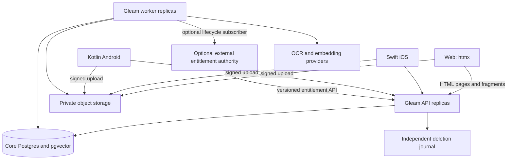

# Libarrie Implementation Design

Version 1.12 • October 27, 2026 • Implementation handoff (frozen)

Revision 1.1 defines recovery, content revision, quota transition, account closure, and snapshot contracts identified during design review. These are implementation defaults within the accepted product scope.

Revision 1.2 closes gaps from a second design review: upload freeze ordering and storage-enforced limits, placeholder and renumbering semantics, a complete lock order, queue fairness and replay keys, native background-upload URL lifetimes, decoder process isolation, thumbnail caching, chunked exports, vector-search layout, fuzzy lexical search, allowance proration and outage protection, deferred processing, permanent purge, closure grace, entitlement typing, and a phasing plan for the heaviest recovery/migration machinery.

Revision 1.3 resolves the follow-up review with conserved coverage allocations, failure recovery holds, versioned cancellable closure, new-page-only deferred uploads, attempt-owned worker slots, portable device backups, lazy placeholder expiration, fixed export retention and substring-aware lexical retrieval. The seven-day cancellable closure grace period and manual deferred processing remain MVP defaults.

Revision 1.4 adopts htmx with Gleam-rendered HTML for the web frontend and establishes a Gleam-package-first policy for all Gleam implementation work, including a documented justification for direct Erlang interop.

Revision 1.5 defines light and dark color schemes sampled from the brand artwork, semantic UI colors, contrast requirements and shared theme behavior across web and native clients.

Revision 1.6 prohibits GPL-family licenses anywhere in the product, admits funded processing directly against each coverage record's own service interval (accounting periods become reporting only), defines browser authentication to `/v1`, protects exports and lifecycle state during closure grace, adds a tenant-leading trigram index, closes the interim journal recency gap, and specifies the web Content Security Policy, htmx session-expiry handling, an OS-level decoder sandbox, platform-only HEIC decoding, status-only sessions for closed accounts, keyed identity hashes, and the missing destructive, disabled, input and overlay theme tokens.

Revision 1.7 confirms three 1.6 defaults as accepted decisions: the GPL-family exclusion scope (including runtime-image C and C++ runtime libraries), two-year retention of the hashed identity usage ledger, and the 72-hour export download window before account closure.

Revision 1.8 completes annual upgrade adjustments, versioned coverage revocation and replacement coverage, lifecycle recovery during delivery outages, notebook numbering concurrency, and mutually exclusive browser/native authentication tests.

Revision 1.9 resolves the two foundation-spike blockers (booting the BEAM without a shell, and hidden GPL-family dependencies in the sandbox and image stack) and freezes this document.

Revision 1.10 folds the remaining review findings into the design: same-origin thumbnail routes, scoped renumber validation, identity-provider deletion ordering, cookie-less native HTTP, partition-key constraints, coverage spend-order tie-breaking, per-part export transcripts and multi-key identity hash lookup. There is no separate backlog document.

Revision 1.11 makes the entitlement authority fully external (ADR 0009). Core contains no commercial concepts; the internal entitlement API, an optional lifecycle subscriber and web extensions compiled into a deployment's own build are the only integration points.

Revision 1.12 records Apache-2.0 as the project license (ADR 0015). The contribution policy is still open.

**Change control.** As of 1.9 this document is frozen. Change it only when implementation or a spike contradicts it, or for a finding that would cause data loss, a security or privacy breach, incorrect entitlements, or blocks implementation; record the reason in an ADR. Everything else goes to the owning work package's issues, not into this document.

Libarrie makes physical handwritten notebooks searchable. Users photograph pages, assign them to a notebook and page number, and later search for information to locate the original notebook and page. The server retains the image, extracts text, indexes passages, and returns evidence-backed page matches.

This document defines the application, deployment architecture, and coordinated implementation work. It is a design, not a claim that any application code exists. Coding agents should implement the accepted decisions, use the explicit defaults below for initial work, and preserve decision gates where a product or operational choice remains unresolved.

## 1 Decision status

### Accepted requirements

- Product name: **Libarrie**. Domain registration and organization ownership are outside this document; do not assume they have been completed.
- The application supports arbitrary personal handwritten notes, not one profession or subject.
- Users create notebooks and upload page images with notebook and page-number attribution.
- Recognition and text embeddings power retrieval. Results identify notebook and page and display original-image evidence.
- Server application components use **Gleam**.
- The web frontend uses **htmx** with server-rendered HTML from Gleam. This is an accepted technology choice.
- When writing Gleam, first look for a suitable Gleam standard-library API or package. Prefer that interface over direct Erlang imports or FFI. Direct Erlang interop is allowed only when it is clearly justified by a concrete requirement and a suitable Gleam interface cannot reasonably meet it; document the reason.
- There are web, native iOS, and native Android clients. iOS uses **Swift**; Android uses **Kotlin**. Do not substitute React Native, Expo, Flutter, or Kotlin Multiplatform.
- API and worker processes run with multiple replicas. Failed or stalled work must become reclaimable.
- Core application and quota management are open source. Entitlements come from an entitlement authority through the documented contract in section 12; core has no knowledge of how an authority decides or funds them.
- Core functionality must operate with no external authority: administrators assign entitlements directly, or the configured defaults apply.
- **No GPL-family licensed software in the product**, with the exact scope defined in section 3 (including runtime-image C and C++ runtime libraries). The requirement and its scope are accepted decisions, not defaults.
- The hashed identity usage ledger is retained for two years after account purge (section 10).
- Account closure is deferred so every export gets a 72-hour download window, capped at 30 days from the deletion request (section 12).
- The project license is **Apache-2.0** (ADR 0015).
- Selected brand: three uneven notebook spines, coral/cream/yellow on navy; the right notebook leans toward the center.
- Web, iOS and Android support the brand-derived light/dark schemes in section 3, with System / Light / Dark selection.
- No app code has been authorized by this document-generation request alone. Subsequent implementation tasks authorize their respective scopes.

### Implementation defaults

These are concrete starting choices, not all separately confirmed product decisions. Agents may proceed with these defaults in an authorized implementation task; material changes require an ADR and coordinator review.

| Area | Default |
| --- | --- |
| Repositories | Public `libarrie` monorepo |
| Server runtime | Gleam targeting Erlang/OTP |
| HTTP | Wisp with Mist, subject to compatibility spike and version pinning |
| Database | PostgreSQL with pgvector; SQL migrations; evaluate `pog` as Gleam client |
| Web | htmx with Gleam-rendered HTML, accessible responsive UI; small browser JavaScript modules for upload/device-specific interactions |
| Native UI | SwiftUI; Jetpack Compose |
| Images | Private S3-compatible storage; hosted default Cloudflare R2 |
| Queue | Durable Postgres job table, leases, heartbeats, attempt fencing |
| Authentication | Standards-based OIDC, managed issuer in hosted mode; local development issuer for self-hosting/tests |
| Models | Provider adapters; evaluate Mistral OCR and Voyage embeddings before production selection |
| API | Versioned JSON REST with OpenAPI 3.1 contract |
| MVP connectivity | Offline mobile capture and queued uploads; online search |

### Gates before public launch

Choose the contribution policy and the remainder of the dependency-license policy (the project license is Apache-2.0 and the GPL-family prohibition in section 3 is already decided); choose hosted authentication provider, production hosts, supported languages and final models.

## 2 Product scope and acceptance

### MVP user journeys

1. Sign in, create a notebook with a name and optional identifying description/color.
2. Capture/import several images, choose the notebook once, assign a starting page number, review the sequence, and upload.
3. See distinct local/upload/processing states and actionable errors without waiting for OCR in a request.
4. Browse ordered notebook pages and inspect the original photograph and extracted text.
5. Search across the library or within a notebook, including exact terms and semantic descriptions.
6. Open a result showing notebook, page number, snippet, and image preview; inspect adjacent pages.
7. Correct transcription, replace a scan, rename/move a page, delete/restore pages, and export data.
8. See remaining stored-page capacity and processing allowance. Existing notes remain readable/searchable at the limit.
9. Administrators, or an external entitlement authority, assign limits and processing coverage.

### Deferred scope

AI-generated answers/chat, summaries, collaboration/sharing, handwriting generation, full offline search, automatic notebook identification, diagram semantic retrieval, handwritten formula guarantees, PDF ingestion, and specialized regulated-data compliance. Do not advertise these in MVP. Preserve raw source images so later processing is possible.

A photographed two-page spread is not automatically two logical pages in MVP: the user crops/splits it before upload. Each accepted image represents one notebook page. Default page numbers are positive integers unique among active pages in a notebook. Roman numerals, inserts such as 12a, covers, and unnumbered pages are a later extension; keep internal page IDs independent of numbering. Because users commonly discover an off-by-one numbering error or a skipped page, MVP includes an atomic bulk renumber (shift a range by an offset, or apply an explicit mapping) rather than requiring page-by-page moves that collide with the uniqueness rule.

### First release completion criteria

A user can capture a page on either native client, observe it on the web, find it by literal and paraphrased queries, and locate it in the physical notebook. Killing a worker during OCR does not strand the job or duplicate user quota charges. Running two API replicas does not permit quota overruns. The stack starts with no external entitlement authority configured.

## 3 Repository and ownership boundaries

```text
libarrie/
  server/
    apps/api/
    apps/worker/
    packages/domain/
    packages/database/
    packages/jobs/
    packages/integrations/
    packages/web/                # Gleam HTML views and web presentation handlers
  clients/web/                   # Styles, pinned htmx, small browser modules and browser tests
  clients/ios/
  clients/android/
  contracts/openapi.yaml
  contracts/fixtures/
  contracts/entitlements/
  database/migrations/
  deploy/
  docs/
  assets/brand/
```

API and worker share domain types, database access, and integration adapters. They have separate release artifacts and independent replica counts. Feature/limit names and the entitlement API are part of the public contract.

Native clients and browser upload helpers share the JSON API specification and conformance fixtures. Native clients maintain idiomatic local models and platform code; generated client types are optional after generator compatibility is verified, with a reproducible generation command for checked-in output. The htmx frontend consumes HTML pages/fragments from Gleam presentation handlers. Those handlers invoke the same domain operations as the JSON API within the server, preserving authorization, quotas, idempotency and concurrency rules without duplicating them or making HTTP calls back into the same process.

External entitlement authorities consume a pinned version of the entitlement contract. Core CI uses fixtures and a mock entitlement issuer. CI jobs run according to changed paths and transitive dependencies. API changes must support older installed native clients; a monorepo does not make mobile release adoption instantaneous.

### Gleam packages and Erlang interoperability

Apply this policy to core, workers, web rendering, integration adapters and tests. Before adding a direct Erlang import, external declaration or wrapper, check the Gleam standard library and available Gleam packages for the needed capability. Prefer a suitable maintained Gleam interface, including one that internally uses Erlang/OTP. Running on Erlang/OTP and using an Erlang-backed Gleam package are normal parts of this design.

Evaluate API fit, OTP/version compatibility, maintenance, correctness, licensing and required operational guarantees. Package-first does not mean adopting an unsuitable dependency merely because its name matches the task. Use ordinary Gleam code for domain logic; do not introduce Erlang just because a familiar Erlang function is convenient.

Direct Erlang interop is an exception for a concrete capability gap or a demonstrated correctness, security or performance requirement that suitable Gleam APIs cannot meet. Examples may include an unsupported OTP primitive or process-control requirement after package evaluation; these are possibilities, not blanket exemptions. Keep any necessary interop small, typed and isolated behind a Gleam module. Record the packages/APIs considered, the missing capability and the reason in the change's handoff/PR; use an ADR for a material architectural exception. Verify the boundary's behavior and failure handling. Routine documented choices within this policy do not require another permission request.

### Dependency licensing: no GPL family

This scope is an accepted decision; changing it requires an ADR and owner approval. The product contains no software under any GPL-family license: GPL, LGPL or AGPL, any version, including "or later" grants, dual licenses where GPL is the only option offered for our use, and GPL-with-exception variants such as the GCC Runtime Library Exception or Classpath Exception. "The product" means everything we author, link, bundle, vendor, generate from GPL-licensed templates, or ship in a release artifact:

- Server and worker container images, including base-image OS packages, the language runtime and every shared library they contain.
- Helper binaries and sandboxes executed by our processes (the image decoder and its launcher).
- The web asset bundle, including WASM modules.
- iOS and Android app binaries and their bundled libraries.

A dual-licensed component is allowed only when we explicitly elect and record its non-GPL license. Infrastructure we operate but do not distribute or bundle is out of scope: a managed database service, a host OS or Kubernetes node, the user's browser, and iOS/Android platform libraries. Development-only tooling that never enters a release artifact (compilers, local emulators, CI runners) is also out of scope, but prefer permissive alternatives. Code generated by a GPL tool is acceptable only if the tool's license grants an explicit exception for its output.

Practical consequences:
- Build runtime images from `scratch` or a minimal base whose every package is non-GPL. Use musl (MIT) rather than glibc (LGPL), and LLVM libc++/compiler-rt (Apache-2.0 with LLVM exception) rather than libstdc++/libgcc_s (GPL with runtime exception) for any C/C++ that ends up in the image, including the Erlang runtime's JIT. Busybox, coreutils, bash and util-linux are GPL and must not be present, so the image has no `/bin/sh` by default. Erlang/OTP and Gleam assume one: `gleam export erlang-shipment` produces `entrypoint.sh`, OTP's `bin/erl` is a shell script that execs `erlexec`, and `os:cmd` and `open_port({spawn, ...})` run through `/bin/sh -c`. Therefore:
  - Boot the release by exec'ing `erlexec` (or `beam.smp` via a release boot file) directly as the image entrypoint, with `ROOTDIR`, `BINDIR`, `EMU` and `PROGNAME` set in the image configuration, or through a tiny static in-repo launcher that sets them. Never use the generated shell entrypoints in release images.
  - All server code and selected packages start external programs only with `spawn_executable` semantics (absolute path plus argument list). `os:cmd`, `open_port({spawn, ...})` and any package that shells out are prohibited in release code; package evaluation checks for them.
  - Operational tasks (migrations, admin CLI, release `eval`/`rpc`) are separate entrypoints that also exec `erlexec` directly; debugging uses an ephemeral debug container, not a shell baked into the release image.
  - If a shell ever proves unavoidable, toybox (0BSD) or mksh (MirOS licence) are the only permitted options, and that requires an ADR.
  The foundation spike proves an Erlang/OTP release (including its JIT built against libc++) boots, serves HTTP, runs migrations and spawns the decoder in such an image.
- Image processing uses permissively licensed libraries only, for example libjpeg-turbo (BSD-style/IJG), libpng (libpng license), libwebp (BSD) and a permissive resizer. libvips (LGPL), libheif and libde265 (LGPL), FFmpeg (LGPL/GPL) and Ghostscript (AGPL) are excluded. Default to a small in-repo decoder binary that links libjpeg-turbo, libpng and a permissive resizer directly. If ImageMagick (Apache-2.0-style) or GraphicsMagick (MIT) is used instead, build it static or with an explicit allowlist of delegates, with `--disable-openmp` (OpenMP pulls in libgomp, a GCC runtime under GPL with exception) and `--without-modules` (the module loader pulls in libltdl, LGPL). FreeType is dual FTL/GPL and, if linked, requires a recorded FTL election; prefer builds without font support.
- Sandbox and process-limit helpers: the default is minijail (BSD), built as C against musl, with its libcap dependency's BSD option elected and recorded (libcap is dual BSD/GPL-2). A small in-repo launcher that applies `setrlimit`, joins a cgroup and execs the decoder is the fallback. nsjail is excluded despite its Apache-2.0 license, because it requires libnl-route-3 (LGPL-2.1) and is C++ built against libstdc++ by default. bubblewrap (LGPL) and util-linux `prlimit` (GPL) are excluded.
- Postgres extensions in our migrations (pgvector, pg_trgm, btree_gin) use the PostgreSQL license. Our development Postgres container may use a stock image because it is development-only; hosted production uses a managed service.

Enforce this in CI: generate an SBOM for every release artifact (container layers, web bundle, mobile apps) and fail the build on any GPL-family license identifier, unknown license or unrecorded dual-license election. New dependencies record their license in the PR. Patent licensing (for example HEVC) is a separate review from copyright licensing; see section 7 for HEIC.

### Brand assets

Existing selected files are `assets/brand/libarrie-icon.png`, `libarrie-github-avatar.jpg`, and `github-social-preview.jpg`. The avatar is 512 by 512, about 40 KB; social preview is 1280 by 640, about 122 KB. Preserve these originals. Production app icons need platform-specific masking/export review, including removal of baked-in exterior margins as appropriate. Do not treat current preview art as a finished adaptive Android icon. The tagline is “Find what you wrote.”

### Light and dark color schemes

Both themes derive from the notebook graphics in assets/brand. Inspect all three assets for overall consistency and use representative flat interior colors from libarrie-icon.png as the canonical UI palette; the raster texture, edge antialiasing and JPEG compression introduce small color variations. The values below standardize those sampled colors, rather than claiming the graphics contain only six exact colors. Preserve the original image files.

| Brand token | Hex | Source in the artwork |
| --- | --- | --- |
| `brand-navy` | `#0E2444` | Icon background |
| `brand-coral` | `#F8926E` | Left notebook spine |
| `brand-cream` | `#FCEFD2` | Center notebook and spine labels |
| `brand-gold` | `#F5BC2F` | Right notebook spine |
| `brand-forest` | `#0D3F2E` | Center notebook binding/detail |
| `brand-paper` | `#FEF8EA` | Warm exterior background |

Light mode uses warm paper and cream surfaces, navy text/buttons, and coral/gold accents. Dark mode uses the original navy as its canvas, lighter navy panels, cream text and coral primary actions. Forest green supplies the success family; blue-gray secondary text echoes the social preview. Supporting shades below are intentionally derived tints/shades for usable contrast, not additional sampled brand colors.

| Semantic token | Light | Dark | Use |
| --- | --- | --- | --- |
| `background` | `#FEF8EA` | `#0E2444` | Application canvas |
| `surface` | `#FFFDF7` | `#173354` | Cards, forms and page-detail panels |
| `surface-raised` | `#FCEFD2` | `#214466` | Menus, dialogs and raised panels |
| `text` | `#0E2444` | `#FCEFD2` | Headings, body text and form labels |
| `text-muted` | `#56616C` | `#B1CDDF` | Secondary text and placeholders |
| `border-strong` | `#887861` | `#809BB0` | Input boundaries and meaningful separators |
| `primary` | `#0E2444` | `#F8926E` | Primary button fill |
| `primary-hover` | `#173354` | `#FFA887` | Primary hover/pressed fill |
| `on-primary` | `#FEF8EA` | `#0E2444` | Primary button text and icons |
| `link` | `#A43E28` | `#FFA887` | Underlined links and text actions |
| `focus` | `#A43E28` | `#FCEFD2` | Keyboard focus outline; dark mode deliberately differs from gold warning/highlight |
| `success` | `#0D3F2E` | `#9CD4B4` | Success text/icons on theme surfaces |
| `warning` | `#795600` | `#F5BC2F` | Warning text/icons on theme surfaces |
| `danger` | `#9F3028` | `#FFB09E` | Error/destructive text/icons on theme surfaces |
| `highlight` | `#F5BC2F` | `#F5BC2F` | Search-match highlight fill |
| `on-highlight` | `#0E2444` | `#0E2444` | Text inside search-match highlights |
| `selection` | `#FAD5C3` | `#FAD5C3` | Selected-item or text-selection fill |
| `on-selection` | `#0E2444` | `#0E2444` | Text/icons over selection fill |
| `danger-fill` | `#9F3028` | `#FFB09E` | Destructive button fill (delete forever, empty trash, account deletion) |
| `danger-fill-hover` | `#852720` | `#FFC6B8` | Destructive hover/pressed fill |
| `on-danger` | `#FFFDF7` | `#0E2444` | Text/icons on destructive fills |
| `input` | `#FFFFFF` | `#0A1B34` | Text field and select background, bounded by border-strong |
| `disabled-fill` | `#EDE6D6` | `#2A4560` | Disabled control fill |
| `on-disabled` | `#6E6A62` | `#8EA3B5` | Disabled control text/icons |
| `scrim` | `#0E2444` at 55% opacity | `#000000` at 60% opacity | Overlay behind dialogs and sheets |

Use semantic tokens in components instead of embedding hex values in views. Brand coral and gold can decorate either theme, but on light surfaces use the darker link/warning tokens for small text. Coral/gold fills always take navy text; do not put cream or white labels on those fills. Success/warning/danger tokens in this table are foregrounds on the three theme surfaces, not interchangeable badge backgrounds. Selection and search highlighting explicitly override their contents with on-selection/on-highlight. Pair status color with words/icons, underline links, and show selection through a checkmark or strong outline as well as a fill. Reserve border-strong for control boundaries; subtle differences between panel fills alone are decorative.

Destructive actions always use the danger-fill tokens plus an explicit verb label ("Delete forever"), never color alone, and never the primary fill. Disabled controls use the disabled tokens, are exempt from WCAG text contrast but still stay above 3:1, and carry `disabled`/`aria-disabled` semantics. Dialogs and sheets use surface-raised over the scrim. Do not add further hex values in views; propose any missing token in the design doc first.

Search highlighting has two forms. In text snippets, use `<mark>` (or the native equivalent) with the highlight fill, on-highlight text and semibold weight, because in light mode the gold fill is only about 1.6:1 against the page and must not be the sole cue. Over scan images, whose paper and ink colors vary, draw each highlight box as a 2-pixel on-highlight (navy) outline with a 2-pixel highlight (gold) outer ring and at most a 30% gold fill, so it is visible on white, cream, gray or dark paper and never hides the handwriting.

The listed body, secondary, link and status text colors were checked against background, surface and surface-raised, together with the paired button, selection and highlight colors: all checked text pairs exceed 4.5:1 (minimum approximately 5.38:1). Border/focus tokens against those three surfaces exceed 3:1 (minimum approximately 3.47:1). The destructive, input and disabled additions were checked the same way: on-danger text on its fills is at least 7.05:1 (light) and 8.83:1 (dark), danger fills against theme surfaces at least 5.74:1, text, muted, link and danger foregrounds on the input background at least 6.3:1 with border-strong at least 4.28:1, and disabled text on disabled fills at least 3.8:1. Body text on the canvas is approximately 14.64:1 in light mode and 13.60:1 in dark mode. These are checks of the specified opaque color pairs, not certification of complete screens. Verify actual rendered states, overlays, images and any new combinations against [WCAG text contrast](https://www.w3.org/WAI/WCAG22/Understanding/contrast-minimum.html) and [non-text contrast](https://www.w3.org/WAI/WCAG22/Understanding/non-text-contrast.html). Use a visible two-pixel focus outline with a two-pixel theme-surface offset so it remains distinct from the control fill. Hover/pressed states keep the specified foreground; avoid opacity that makes normal text unreadable.

Provide a System / Light / Dark preference on web, iOS and Android, defaulting to System. Persist an explicit override per device/browser and follow operating-system changes while System is selected. On the web, map these names to CSS custom properties on the document root, use prefers-color-scheme for System, set color-scheme for browser controls, and render any saved preference before first paint. A non-sensitive preference cookie may support server rendering; note data does not belong in that cookie. htmx fragments inherit the current root tokens and must not reset theme or flash a different background on swaps/history navigation. Native semantic color resources use the same palette and preference behavior; respect platform increased-contrast/forced-color accessibility settings.

Keep notebook scans, export originals and brand graphics at their original colors in either theme: do not invert, tint or apply dark-mode filters to source images. Frame scans with the current theme surface, and use the existing navy-backed brand artwork consistently. The website UI and native chrome change theme; users' handwriting and evidence do not.

## 4 Runtime architecture



The API is stateless with respect to durable business state. Do not depend on sticky sessions, an in-memory global quota counter, or Erlang node clustering for correctness. Worker ownership is recorded in Postgres. Database and object-store services need their own availability strategy; multiple application replicas do not eliminate those dependencies.

Use one logical core database primary initially. Reads affecting quota decisions and job ownership must use the primary. Bound aggregate connection pools across replicas. Add replicas only within the database connection budget. Ongoing OCR calls do not hold database transactions or locks.

Internal HTTP endpoints are separately authenticated and preferably private-network restricted. Core exposes liveness and readiness endpoints with no sensitive information.

## 5 Core domain and data model

Use opaque UUID identifiers, UTC timestamps, explicit schema migrations, and monotonically increasing versions for optimistic concurrency. Client-generated operation IDs support retry deduplication. All tenant-owned data belongs to an `account_id`; MVP has one personal account per user, leaving space for future account membership without implementing teams now.

| Entity | Important fields and constraints |
| --- | --- |
| users | id, display_name, created_at; no plaintext credentials |
| identities | user_id, issuer, subject; unique issuer/subject, never identify solely by email; deleted at account purge |
| identity_usage_ledger | identity_key (HMAC-SHA-256 of issuer and subject under a dedicated, rotatable-by-re-keying secret), lifetime_units_consumed, account_status, updated_at; holds no raw issuer/subject, email or name; retained for exactly two years after purge, solely for lifetime-allowance abuse prevention, then deleted; the privacy policy discloses this and its legal basis |
| accounts | id, owner_user_id, status: active/closure_scheduled/closing/closed, closure_requested_at, closure_effective_at, lifecycle_revision, content_sequence, active_search_release_id, allowance_schedule_id, created_at |
| notebooks | id, account_id, name, description, color, version, numbering_revision, deleted_at, deletion_batch_id |
| pages | id, account_id, notebook_id, page_number, visibility, active_revision_id, pending_revision_id (source revisions), version, content_version, deleted_at, deletion_batch_id |
| page_revisions | id, page_id, source_object_id, selected_transcript_revision_id, source_generation, status, error_code, created_at; immutable source identity |
| objects | id, account_id, bucket, key, content_type, bytes, checksum, state, backup_status, backup_verified_at, created_at, purge_after |
| operations | id, account_id, kind, request_hash, status, failure_fault (user/system), client_label, upload_accepted_at, result references, parent_operation_id, charge_root_operation_id, recovery_hold_id, terminal_reason; unique account/id for the account lifetime |
| upload_sessions | id, operation_id, account_id, page_id, revision_id, staging_key, expected_bytes, status, expires_at; unique account/operation |
| ocr_results | id, revision_id, processing_version, raw_text, recognition_outcome, language, provider/model metadata, artifact references; immutable |
| transcript_revisions | id, revision_id, parent_id, ocr_result_id, text, origin: ocr/user, created_at; immutable, selected separately from search publication |
| index_generations | id, account_id, revision_id, transcript_revision_id, configuration_id, state, created_at; derived immutable snapshot |
| passages | id, account_id, index_generation_id, ordinal, text, normalized text, text offsets, optional normalized bounding boxes, text-search vector; hash-partitioned by account with a per-partition `(account_id, normalized_text)` btree_gin/trigram index; primary key `(account_id, id)` because Postgres requires the partition key in every unique constraint |
| embeddings | passage_id, account_id, index_generation_id, configuration_id, vector, model_id, dimensions; hash-partitioned by account; unique `(account_id, passage_id, configuration_id)`; composite foreign key `(account_id, passage_id)` to passages; account and generation denormalized so tenant filtering needs no joins |
| search_releases | id, account_id, configuration_id, state, backfill_sequence, applied_sequence, created_at |
| search_release_pages | release_id, page_id, index_generation_id; unique release/page |
| content_changes | account_id, sequence, page_id, content_version, action; durable account-ordered migration catch-up log |
| jobs | id, account_id, operation_id, revision_id, transcript_revision_id, configuration_id (as applicable), stage, dedupe_key, replay_generation, state, run_after, attempts, owner_id, attempt_token, lease_expires_at, heartbeat_at, stage_deadline, last_error |
| job_attempts | job_id, attempt_number, token, timestamps, outcome, provider request ID, sanitized error |
| entitlement_assignments | account_id, source, revision, effective_at, limits, feature flags, processing-period policy |
| usage_periods | account_id, period_id, kind: lifetime/reporting, schedule_id, starts_at, ends_at, allowance (lifetime only), used, reserved; the lifetime period is an admission source; reporting periods only aggregate consumption for display and never gate admission |
| processing_coverage | account_id, coverage_id, starts_at, ends_at, admission_end_at, authorized_units, used, reserved, revoked_unreserved, kind: base/upgrade, parent_coverage_id, funding_change_id, funded_monthly_budget, authority_revision, confirmation_state; immutable funding identity and service interval, with a revocation-derived admission cutoff |
| coverage_revocations | account_id, authority, revocation_id, coverage_ids, effective_at, reason, authority_revision, payload_hash; immutable, idempotent termination of new admissions, preserving pinned allocations |
| recovery_holds | id, account_id, charge_root_operation_id, original_allocation_id (coverage, lifetime period or credit grant), source_revision_id, request_hash, state, active_retry_operation_id, first_failure_at, claim_deadline; unique charge root |
| account_job_slots | account_id, occupied, limit; count of unreleased slot leases, including expired attempts awaiting transition |
| job_slot_leases | job_id, account_id, attempt_token, state; unique live lease per job, transferred atomically on reclaim |
| quota_reservations | id, account_id, operation_id, allocation_attempt, page_slots, processing_units, exactly one of coverage_id, lifetime period_id or credit_grant_id; page_slot_state, processing_state, expires_at |
| usage_events | id, account_id, operation_id, charge_root_operation_id, meter, amount, reason; unique charge/refund key for charge root and meter |
| credit_grants | id, account_id, external_grant_id, granted, reserved, consumed, expiry; unique external_grant_id |
| idempotency_records | account_id, endpoint, key, request_hash, response, expires_at |
| exports | id, account_id, state, scope, snapshot_at, completed_at, manifest_version, part_count, expires_at |
| export_parts | export_id, part_number, object_id, bytes, checksum, ready_at; URL issuance is not a download receipt |
| export_items | export_id, ordinal, part_number, page_id, source_revision_id, transcript_revision_id, object_id, frozen notebook/page metadata; immutable manifest rows |
| artifact_pins | owner_kind, owner_id, artifact_id, expires_at; block ordinary garbage collection |
| provider_spend | account_id, operation_id, attempt_id, provider, budget_window, estimated_reserved_cost, actual_cost, outcome; independent of user usage ledger |
| lifecycle_outbox | command_id, account_id, lifecycle_revision or deletion generation, destination, full desired-state payload, payload_hash, state, acknowledgement, retry_at; durable and idempotent |
| audit_events | actor, account_id, action, target, request_id, timestamp; no raw notes or credentials |
| deletion_tombstones | local projection of independent journal records; account/page/object scope, generation, journal sequence, action, timestamps and retention deadline |

Enforce account consistency with composite foreign keys where practical, not only request handlers. Pages carry a `visibility` of `placeholder` (admitted new-page upload not yet accepted), `active`, `restore_pending` (restore claim awaiting journal acknowledgement) or `trashed`. Page-number uniqueness covers every state except `trashed`, so placeholders and restore claims hold numbers through the same constraint as active pages; a trash restore conflicts if the number is now occupied. Implement it as a deferrable exclusion constraint (`EXCLUDE USING btree (notebook_id WITH =, page_number WITH =) WHERE (visibility <> 'trashed') DEFERRABLE INITIALLY IMMEDIATE`) so bulk renumbering can defer the check to commit; a plain partial unique index cannot be deferred. Every read, list, search, export and count path selects `active` explicitly; placeholders are visible only as upload-progress items to their own operation. Expiry, cancellation and failure before acceptance delete the placeholder in the same transaction as the reservation release. Time passing alone does not execute a database transition. Before testing quota or target-number conflicts, admission/restore/renumber paths discover relevant expired, unaccepted upload reservations and lazily expire them under the shared lock order using database time. Revalidate expiry and non-acceptance under lock, fence completion, release each allocation once, and remove its placeholder before admitting the new claim. For quota checks, expire the account's abandoned upload reservations too; if bounded cleanup must continue, return a retryable cleanup-pending result rather than a false capacity/number conflict. A background sweeper uses the identical domain operation but is not needed for reuse on the next request. If completion already won acceptance, keep the active page and return a real conflict. Concurrent completion must reject an expired or cancelled reservation, even if its signed upload URL still works. Foreign notebook IDs never authorize cross-account moves. Tenant identifiers come from trusted authentication, not client assertions.

### Source, transcript and search revisions

Source-image revisions, saved transcript revisions, and derived index generations are separate identities. Original scans, OCR results, saved transcript revisions, and processing artifacts are immutable. A page's active/pending revision IDs identify source images; each source selects a saved transcript independently of search publication. An index generation pins an exact source, transcript and model/chunking configuration. Foreign keys enforce these relationships and account ownership. API responses expose source `revision_id`, `transcript_revision_id`, `index_generation_id`, and indexing status explicitly.

A text correction uses If-Match plus the target source/transcript IDs. The transcript and reprocess endpoints expose and match `content_version` as their ETag, while attribution edits (rename, move, renumber) match the resource `version`; a rename on one device therefore never produces a 412 for a text edit on another. Its transaction saves and selects a new user transcript immediately, advances the page content version/account content sequence, records a content-change event, and queues indexing. Page detail and exports show that saved text even if embeddings fail. Search may temporarily return the previous published generation with its revision IDs and `indexing_pending`; it must not attach old highlights to the newly saved text. Further corrections supersede obsolete indexing work without losing saved text. Correcting text requires no OCR and consumes no successful-page processing unit; internal cost/abuse controls still apply.

A replacement requires If-Match and records its base content version. Only one source replacement or explicit OCR reprocessing operation may be pending per page. Initial OCR processing also holds this source-operation guard. While it is pending, corrections and another replacement/reprocess return 409 `processing_conflict`; the error details name the blocking operation ID, kind, originating client/device label, state and creation time, and every client (not only the originating one) offers waiting or explicitly cancelling that operation before editing. A replacement still `awaiting_upload` blocks edits for at most its reservation lifetime. Saving corrections may proceed while correction-only indexing is pending. Starting a replacement after a saved correction does not discard that correction; it remains attached to the previous source. Replacement publication checks the base content version, pending operation, account/page visibility and worker ownership atomically. Moving/renumbering a page changes its resource version but not its text/source content version.

Re-running OCR on the same image stores a new raw result. If the selected transcript contains user edits, it remains selected; the new OCR text is a candidate the user may explicitly accept using If-Match, creating another transcript revision. Without user edits, the new OCR text can become selected at successful reprocess publication. A replacement image starts a new transcript lineage; never silently copy corrections or bounding boxes from the old image. A failed/cancelled replacement leaves the previous source and search result available. At acceptance an initial upload sets the page's active source immediately, even before OCR/indexing; a replacement instead sets the pending source. Initial uploads remain visible and exportable as processing/failed before they have a searchable generation. Bound retained history, but never collect the currently selected saved transcript or any pinned export/migration artifact.

Users can permanently purge a non-active source revision (for example an earlier scan that captured something sensitive) and its derived OCR results, transcripts, passages, embeddings and previews without trashing the page. Purge is journaled like other lifecycle actions, invalidates exports pinning those artifacts, and removes primary-storage objects promptly; independent backups still age out on the documented backup window, which the confirmation UI states. The active source cannot be purged directly; replace it first.

## 6 Authentication and isolation

Use OIDC Authorization Code flow. Native clients use PKCE and the system browser, with credentials stored in Keychain/Android secure facilities. The web uses a backend session with HttpOnly Secure cookies; state-changing cookie requests require CSRF protection and appropriate SameSite behavior. Do not store refresh tokens in browser local storage. Validate issuer, audience, expiry, signature, and nonce/state as applicable. Account linking is explicit.

OIDC provider selection is a gate, but implement a replaceable identity adapter and local test issuer. Logout/revocation and account deletion must invalidate sessions. Account deletion and permanent purge require recent authentication: request a fresh OIDC login (`prompt=login` or `max_age` with `auth_time` validation) no older than five minutes. Until purge, a closed account's identity mapping remains; after purge only a keyed hash of issuer/subject survives in `identity_usage_ledger` (section 10). A later sign-in with the same issuer/subject reports the account as closed and may create a new account only as an explicit choice, which inherits the identity's prior lifetime usage and receives only its remaining lifetime allowance (see section 10). Internal entitlement-authority credentials are distinct from end-user sessions and scoped only to entitlement/credit operations; never allow them to read notes.

Every page, notebook, search, export, and object URL operation verifies account ownership and requires an `active` account, or a `closure_scheduled` account for reads, exports, deletions and closure cancellation only; a valid OIDC token alone does not authorize a closing account. Return 404 for inaccessible resource IDs rather than disclosing their existence. Original notes are never public bucket objects. Logs exclude raw images, note text, query text, signed URLs, and bearer tokens by default. Self-hosters receive clear configuration for external model processing; do not promise end-to-end encryption while the server processes plaintext.

Hosted mode enables a model provider adapter only after its terms are recorded as: no training on submitted content, zero or bounded data retention, a signed data-processing agreement, and a documented processing region. The privacy policy lists these subprocessors. Although specialized regulated-data compliance is deferred, ordinary personal-data obligations (access/export, erasure, subprocessor disclosure, regional transfer basis) apply to any hosted user and are a launch gate.

Original images keep their exact bytes, including camera metadata. Native clients strip GPS/location EXIF at capture by default (a user setting can keep it), and the web client warns when a selected file contains location metadata. Derived images and exports' preview files always omit location metadata; exports include originals as stored.

Direct image/preview/export download URLs expire five minutes after issuance by default, with a hosted hard maximum of five minutes. Original images and export archives use `Cache-Control: private, no-store`. Thumbnails and previews use `private, max-age` up to 24 hours with no shared/CDN caching, so page grids and recently viewed pages do not refetch on every scroll or URL rotation. Browsers can only cache by URL, and rotating signed URLs would defeat that, so the web serves thumbnails and previews from stable same-origin routes (`/img/{object_id}/thumb` and `/img/{object_id}/preview`). Those routes authorize the session and account on every request, stream the bytes from object storage, and send `private, max-age` with no redirect to a signed URL; they satisfy the CSP's `img-src 'self'`. Originals and export parts keep direct five-minute signed URLs. Native clients key their image caches by account and immutable object ID (not by signed URL), may keep previews for offline viewing, and clear all account-specific caches on sign-out or account switch. Session revocation or transition to `closing` stops new URL issuance immediately; `closure_scheduled` still permits authorized reads and exports. Previously issued bearer URLs may start requests until they expire, and an in-progress download or previously downloaded copy cannot be recalled. Product/API wording must state this bounded residual access explicitly. Upload URLs have the separate lifetimes in section 7; closing accounts cannot complete uploads, and late staging bytes are swept. If a deployment requires authorization on every new download request, use a streaming authorization gateway instead of direct signed URLs; it must not redirect to reusable storage URLs.

## 7 Upload protocol and page processing

### Upload lifecycle

1. Client saves the image and metadata locally under a stable operation UUID. It normalizes orientation and can produce a JPEG, preserving a readable original capture locally until completion.
2. `POST /v1/upload-sessions` supplies the stable client operation UUID, notebook ID, page number or replacement page ID, exact byte size, content type, SHA-256 checksum (required), processing mode (`immediate` or `deferred`) and client label; replacements also supply If-Match. The operation UUID is the durable deduplication key for this endpoint; an `Idempotency-Key` header, if sent, must equal it, and a mismatch returns 400.
3. API transaction follows the shared account/usage/page lock order, lazily expires relevant abandoned reservations, verifies available storage capacity, checks page-number conflicts, reserves one page slot and creates a `placeholder` for a new page, reserves one processing unit unless the mode is `deferred`, creates revision/session, and commits. In MVP, `deferred` is valid only for a new logical page. A replacement with `deferred` returns 422 `deferred_replacement_unsupported` before creating an operation, source guard or reservation. When storage fits but processing allowance is exhausted, an immediate new-page request fails with `processing_limit_reached` and details offering deferred upload. A replacement instead stays queued on the device until ordinary processing admission is available; the existing source and search result remain unchanged.
4. API returns a URL to a unique staging key, required headers, and upload constraints. The signature binds `Content-Length` to the declared size and `x-amz-checksum-sha256` (or the store's equivalent signed checksum header) to the declared checksum, so the object store itself rejects oversize or mismatched bodies; the hosted store must be verified to enforce both before launch, and a store that cannot must use an API upload proxy instead. Initial defaults: JPEG/PNG, 20 MB maximum, one image per page. Native HEIC input is converted client-side with the platform's own decoders (ImageIO, Android ImageDecoder); the web client converts HEIC/HEIF only where the browser decodes it natively and otherwise asks for JPEG (section 13). The product bundles no HEVC/HEIF decoder. Revalidate these limits with real photographs before launch.
5. Client uploads bytes directly to storage and calls `POST /v1/upload-sessions/{id}/complete` idempotently.
6. Freeze first: copy the staging object to a new immutable final key, conditioned on the staging ETag observed at the start of completion (`x-amz-copy-source-if-match`) and verifying size/checksum of the copy. Presigned staging URLs may remain usable until expiration, so validation and processing must never read the mutable staging object. Record the final key in a pending-object row before the copy so a crash between storage and database writes is reconciled rather than leaked.
7. Validate the frozen final object, never the staging object: actual file signature, dimensions, decode limits (in the isolated decoder process of section 7), size and checksum. A signed URL is permission to upload, not proof of content validity; do not use multipart ETag as a universal checksum. Invalid bytes delete the final copy and fail with `unsupported_image`.
8. In one database transaction recheck account, reservation expiry and operation state, mark the upload accepted, convert any new-page slot reservation to stored usage and its placeholder to `active`, attach the immutable source, and either enqueue the first processing job or, for a deferred new page, record `awaiting_processing`. Replacements attach only a pending source and consume no extra page slot. An already accepted session returns the same result.
9. Acceptance means stored in primary storage, not independently backed up. Native clients retain the local image by default until the API reports `backup_status: verified` for a recoverable source-plus-metadata backup manifest. Users may explicitly remove an accepted but not independently backed-up copy after the UI explains the recovery window. Processing success is independent of backup status. Browser clients explain the same distinction and do not promise to preserve selected local files after browser shutdown.

Interactive (foreground) staging URLs expire after approximately 15 minutes. Native background transfers are scheduled by the operating system and may start hours later while the app is not running to refresh them, so native clients request `transfer: background` and receive URLs valid for up to 6 hours, never beyond the reservation expiry; the signature's size/checksum binding and the freeze-before-validate rule make the longer window safe. A background transfer that still fails with an expired URL returns to `reserving` and refreshes on next app launch. Upload reservations expire after approximately 24 hours by default. Refreshing a URL retains the same operation/reservation.

Deferred new pages are stored, viewable and exportable but initially unsearchable, and report `awaiting_processing`; they hold no source-operation guard while waiting. Users may supply a manual transcript through the ordinary free correction flow, after which the page is no longer awaiting deferred OCR and can be indexed normally. `POST /v1/pages/process-deferred` accepts page IDs plus their expected active source IDs and admits as many eligible pages as processing capacity allows, each with a client operation UUID and atomic source-guard/reservation acquisition. Return a per-item admitted/already-admitted/conflict/limit result in stable notebook/page/ID order. Repeated or concurrent batches cannot start two operations for one source. A page whose source or state changed is reported as a conflict rather than OCRing the wrong image. Manual admission is the MVP default; a later opt-in auto-admission setting must use exactly the same contract. Expired sessions cannot silently publish late uploads. Cleanup removes orphaned staging objects after a grace period using a durable job. Accepted processing reservations stay attached to the operation through queue delays; they are not swept as abandoned uploads.

### Durable operation recovery

Require a unique `(account_id, operation_id)` operation record and canonical request hash in the same transaction as session creation and reservations. Short-lived HTTP idempotency response caches are an optimization; expiring them must not expire logical deduplication. Retain a compact terminal operation record for the account lifetime, including accepted/cancelled/expired outcome and stable result IDs, even after staging/session details are purged. Closed accounts cannot replay mutations.

`GET /v1/operations/{operation_id}` resolves an account-owned operation without knowing the server session ID. A lost create or complete response is recovered through this endpoint or by replaying the original POST. The same operation and body return its existing status/result without new reservations; a changed body returns 409. A recovery retry must also claim its existing charge-root hold, rather than treating a new retry UUID as fresh quota. Expired/cancelled operations remain terminal and never mint another session. After confirming a terminal outcome, an explicit retry uses a new operation UUID referencing the old operation. A not-found lookup allows retry of the original UUID, not creation of a different one; this handles a still-in-flight initial request safely. An accepted result remains accepted if its page later enters trash, with current visibility reported separately.

`POST /v1/operations/{operation_id}/cancel` is idempotent, checks ownership and fences further publication. Before acceptance it releases both reservations and removes the pending page-number placeholder. After initial acceptance it retains the viewable image/page slot and releases unconsumed processing capacity. Cancelling a replacement retains the previous active source; ordinary bounded history cleanup removes the cancelled candidate. Completed operations return their existing outcome; cancellation cannot undo a completed charge.

### Stages and state

`awaiting_upload -> validating -> queued -> recognizing -> indexing -> ready`, with `ready_empty`, `needs_user_action`, `failed`, `cancelled`, `superseded`, and `deleted` terminal alternatives for that operation. A deferred upload ends its upload operation at acceptance and leaves the page `awaiting_processing`; its later processing is a separate admitted operation. Every terminal `failed` outcome records `failure_fault`: `user` (invalid or unsupported content) or `system` (provider outage, exhausted transient retries, budget pause timeout, operator error). A user retry starts a linked new operation; administrator recovery may replay the existing operation as specified below. Internal jobs divide work into validation/preview generation, recognition, passage construction, embedding, and publication. Each stage persists output before the next stage is enqueued in the same transaction.

Recognition must return a classified outcome: `text_detected`, `blank_confirmed`, `unreadable`, `unsupported_content`, or `provider_error`. An empty text string alone is not proof of a blank page. A valid empty response without a supported blank determination becomes `needs_user_action: no_text_detected`; low-confidence or illegible content becomes `needs_user_action: unreadable`. These outcomes do not auto-retry or consume a successful-page processing unit. Users can keep the image, supply a transcript, confirm blank, or start an explicit rescan. Unsupported image bytes fail validation; valid images with unsupported language/content remain viewable with an actionable explanation. Transient provider errors follow bounded retry policy.

A confirmed blank page publishes `ready_empty`, stores an empty transcript, skips passage/embedding calls, and has no text search result. A machine-confirmed blank completes the admitted processing operation and consumes its reserved unit once. If the earlier no-text operation already released its reservation, user confirmation of blank or manual transcription is a free content edit, not a retroactive charge. This distinction is visible in operation/usage responses. Replacement by a confirmed blank removes the previous text result atomically. Tests/evaluation include blank paper, diagrams without text, faint handwriting and malformed provider responses.

OCR output includes text, reading order, language, and optional bounding boxes/confidence. Store model/prompt/adapter version. Never invent bounding boxes when unavailable. Recognition uncertainty is displayed as an editable transcript, not presented as a guaranteed accurate copy.

Chunk by headings/paragraphs where possible, initially targeting roughly 200–500 tokens per passage with bounded overlap. Keep page attribution, offsets, and page order. Short pages may be one passage. Do not split a page into arbitrary fixed characters or embed only a summary.

Thumbnail generation is a replaceable image-processing adapter invoked from Gleam; a maintained, permissively licensed native image tool/library is acceptable (section 3 lists allowed and excluded examples). All server image decoding (validation, thumbnails, previews) runs in a separate OS process with CPU-time, memory and wall-clock limits. Neither Gleam packages nor Erlang ports can impose CPU or memory limits on a child process, so the limits come from an OS-level launcher: minijail (BSD, per section 3) in production, configured with rlimits (address space, CPU seconds, file size, open files), a cgroup v2 memory/pids limit where available, no network, a read-only filesystem except a per-job scratch directory, and a seccomp allowlist. A small in-repo launcher that applies `setrlimit` before exec is an acceptable fallback for self-hosters without namespaces, documented as weaker isolation. GPL-family tools (bubblewrap, util-linux `prlimit`) are excluded by section 3. Gleam starts and supervises the launcher through a suitable Gleam process-management package and enforces the wall-clock limit; direct Erlang port interop is permitted only after documenting why the available Gleam APIs cannot provide that control. The foundation spike proves the launcher kills an over-limit decoder and that the worker observes the failure. Decoding runs never as a NIF linked into the worker VM: a decoder crash on a malicious or malformed image must kill only that subprocess, not the BEAM node and every job leased on it. A decoder crash or limit breach is a user-actionable `unsupported_image`, not a transient retry. Each lease reclamation counts as an attempt, so a job that repeatedly takes down its worker still exhausts its attempts instead of cascading across replicas. Apply orientation, strip unnecessary location metadata from derived images, bound pixel counts, and isolate decoding failures. The original-data retention policy must distinguish an exact original from any normalized upload.

The successful publication transaction checks account/page/notebook state, current operation and source/transcript content version, job attempt ownership, and indexing completeness (or the explicit ready_empty exemption). It verifies that the output configuration still matches the active search release before updating that release's page mapping and applying any source switch. If a model cutover overtook this work, reuse valid persisted OCR/text, queue indexing for the new configuration and keep the original billable reservation pending; never publish incompatible vectors or charge twice. The transaction records the account content change and converts a billable operation's reservation to a charge once. Corrections and model migrations carry no billable processing reservation. Deleted or superseded work cannot publish. A replacement consumes no extra active page slot. Any visibility/source change races under the same account/page locking order as publication; historical objects obey retention and pin rules.

## 8 Durable workers and recovery

Postgres is the queue authority. A job is claimable when scheduled and pending/retryable, or when its running lease has expired. Use short `FOR UPDATE SKIP LOCKED` claim transactions. Set a new random attempt token, worker ID, attempt count, lease expiry, and stage deadline atomically. Add a dedupe key containing the logical operation, source/transcript inputs, stage, configuration/processing version and `replay_generation`, unique only among non-terminal jobs (a partial unique index on non-terminal states). Audited administrator replay increments `replay_generation`, so it can enqueue the same logical work again while a still-running duplicate remains impossible. Two explicit rescans of the same source are different operations; indexing two different saved transcripts cannot collapse into one job.

Initial configurable settings: heartbeat every 30 seconds, lease 120 seconds, provider request timeout approximately 90 seconds where provider mode permits, stage deadline approximately 5 minutes, five attempts, exponential backoff with jitter capped at 15 minutes. Asynchronous provider APIs use polling jobs and persisted provider operation IDs rather than holding one call open indefinitely. These settings need provider-specific tuning.

### Fencing and progress rules

- Heartbeat renewal uses `WHERE attempt_token = current_token AND state = running AND lease_expires_at > database_now AND stage_deadline > database_now`. An expired owner cannot revive itself.
- Database time defines lease validity. Renewal does not extend the fixed stage deadline.
- Heartbeat execution must remain responsive during network calls. Separately track deadline/progress so a live but stuck task is reclaimed.
- Before committing stage results, lock the job row and validate token, lease, deadline, and page generation in the same transaction as all canonical writes. If validation fails, discard late results. Follow the shared account/page/operation/job lock order; do not first lock the job and then acquire account locks in the reverse order. A token check followed by unlocked writes is insufficient.
- Persisted provider responses/artifacts are attempt-specific immutable objects until accepted by a fenced transaction. Garbage collection cleans rejected output.
- Reclaiming a job creates a new token. Every replica may perform reclamation; no singleton coordinator is needed.
- Periodic cleanup/reconciliation tasks also use deduplicated leased jobs so multiple schedulers are safe.

A worker that cannot renew must stop initiating side effects and cancel provider requests where possible. Existing external calls may complete anyway; assume at-least-once execution. Unique constraints and transactional ledgers prevent duplicate logical results and user charges. A provider may charge twice if a request succeeded before a crash and has no retrieval/idempotency support; record this operational cost, never bill the user twice for the same operation.

Retries classify errors: timeouts/429/temporary 5xx retry; invalid image and unsupported content are user-actionable failures; invalid provider credentials pause affected processing and alert operations instead of exhausting every user job. Exhausted jobs enter terminal failed state with a sanitized reason. Administrator replay is audited and retains the same logical charged operation. User-requested rescans are new operations.

At terminal user-fault processing failure or needs_user_action, release unconsumed processing capacity; retained accepted images still consume a page slot and remain viewable. An explicit rescan follows ordinary admission. Before source acceptance, failed upload/validation operations release their allocations normally and can be retried through upload admission; they have not begun billable model processing. After source acceptance, a terminal system-fault processing failure instead atomically converts its unconsumed allocation into a recovery hold; it does not make that capacity available to unrelated work. The hold remains included in the original coverage record's, lifetime period's or grant's reserved total even after that coverage ends or the grant expires, so no expired grant is reinstated and no ended coverage is newly funded.

There is at most one recovery hold per charge root operation. It is bound to the account, original source revision and processing request; a changed image/purpose is a new charged operation. The default claim deadline is 30 days after the first system failure, is visible to the user, and is not extended by repeated failures. A user retry may have a new operation UUID, but it and administrator replay must claim that same hold and charge root atomically. At most one retry is active; other claims return the existing operation/conflict. A successful retry consumes the held allocation exactly once using a unique charge-root charge key, regardless of how many operation IDs were linked.

A repeated system failure returns the same allocation to the hold with its original deadline. Unclaimed holds expire at that deadline; an admitted retry can settle after it under normal stage deadlines, but a failure after the deadline releases the hold. Explicit cancellation, source supersession, deletion or closure releases it; if the original coverage has ended or the grant is expired or revoked, that release creates no currently spendable capacity. User-fault outcomes on retry release it too. Retrying after release requires normal admission and explicit user confirmation of the displayed allowance cost. Corrections and migration jobs are not charged; they have no processing allocation to hold and still incur no user charge on replay. Recovery holds are shown separately within reserved usage, while internal cost limits apply to every attempt. Cancelled/superseded work cannot be revived by an old worker. Graceful shutdown stops claiming, drains within a deadline, then relies on lease expiry for unfinished work.

Provider concurrency limits must apply across replicas, not just per process. Start with Postgres-backed expiring provider permits or a documented global concurrency budget with admission control. Do not let horizontal scaling multiply provider traffic beyond limits. Fair scheduling bounds each account's active jobs and prevents one archive import monopolizing workers. A per-account cap cannot be enforced by counting running jobs inside a `SKIP LOCKED` claim, because concurrent claimers each see the old count. Keep an `account_job_slots` row plus a token-owned slot lease for each claimed job. Read candidate IDs without locks, then lock account/slot rows and the selected job in the documented order and recheck eligibility. Fresh pending/retryable claims atomically increment `occupied` only when `occupied < limit`, create a slot lease for the new attempt token, and mark the job running.

Reclaim of an expired running attempt transfers its existing slot lease to a new token and leaves `occupied` unchanged; it does not require spare capacity, even when the account is at or above a newly lowered limit. Reclaim must increment the attempt count and obey attempt/deadline limits. If no further attempt is allowed, terminate the job and release the old slot atomically instead. Completion, failure, retry backoff or cancellation releases a slot only if the slot's token equals the terminating job attempt's current token; an obsolete worker cannot release its successor's slot. Each live slot is released once. Expiry alone does not decrement the counter. A reconciler uses the same lock order and explicit expired-job transitions, then compares `occupied` with unreleased slot-lease rows, rather than resetting it from a count of only unexpired jobs. Missing/inconsistent leases are repaired under those locks before new admission. These rules bound authoritative running attempts; already-sent provider requests from expired workers remain subject to the separate provider-permit rules.

The job table is high-churn (heartbeat updates every 30 seconds per running job). Tune autovacuum for it, keep heartbeat updates narrow, and move terminal jobs to an archive table or partition promptly so claim scans stay small.

## 9 Search design

`POST /v1/search` takes a query, optional notebook filter, and a bounded result count. Embed the query using the same index version/configuration as the documents. In parallel when feasible, perform lexical retrieval from normalized passage text and semantic retrieval from compatible embeddings. Merge ranked candidates using a documented method such as reciprocal rank fusion, aggregate passages by page, and return one result per page with its best evidence.

Start with exact account-filtered vector search and benchmark before adding approximate indexes. Size it honestly: a 30,000-page account at about three passages per page and 1,024 float4 dimensions is roughly 370 MB of vectors per exact scan. Filter directly on the denormalized `embeddings.account_id`/`index_generation_id` (with a release-page join only for the final visibility check), hash-partition embeddings by account, prefer `halfvec` storage or a smaller dimension where evaluation shows no recall loss, and include a maximum-tier account in the load test. If exact search misses the search latency target for large accounts, switch those accounts to a measured approximate strategy rather than raising the target silently. With approximate pgvector indexes, tenant filters can reduce recall; validate results against exact search and use supported iterative scans or another measured indexing strategy. Never obtain global results and rely on client filtering for privacy. Deleted pages and non-active revisions are excluded in SQL.

Names, identifiers, and dates must have a lexical path. Preserve punctuation-bearing source text even when search normalization removes punctuation. Start with a language-neutral text-search configuration plus explicit exact-term handling; choose stemming/language strategies through evaluation. Full Unicode text must survive ingestion. Recognized handwriting contains misreadings (a name read with one wrong letter), so exact tokens alone make the lexical path brittle precisely where it is meant to rescue semantic search. Add a trigram (`pg_trgm`) candidate list using `normalized_query <% normalized_passage` for indexed candidate selection and `word_similarity(normalized_query, normalized_passage)` for ranking. This compares the query with an extent within a passage; do not substitute whole-passage `similarity(query, passage)` or `%`, which dilutes a short name against unrelated text. A single global trigram index would make every query walk posting lists for all tenants' passages and filter by account afterward, so common trigrams cost time proportional to the whole deployment. Hash-partition `passages` by `account_id` with the same partition count as embeddings, and within each partition build a multicolumn GIN index on `(account_id, normalized_text gin_trgm_ops)` using `btree_gin` (PostgreSQL license) so the planner intersects the account's entries with trigram matches inside one small partition. Every lexical query includes `account_id = $1` so partition pruning applies. Measure with many tenants and a maximum-tier account; if posting-list intersection is still too slow, raise the partition count. Keep tenant/current-generation filtering before candidate truncation, and calibrate the word-similarity threshold on the handwriting evaluation set. Preserve an exact normalized token/substring path for identifiers and very short queries where trigrams are weak; bound short-query scans by account and query limits. Evaluate misspelled names inside long passages, punctuation-bearing IDs and one/two-character queries separately. Postgres word-based text search does not segment Chinese, Japanese or Thai; until a segmenting configuration is evaluated for supported languages, trigram matching is the lexical path for those scripts, and supported-language claims must reflect measured results.

Default result count is 10, maximum 50. Return snippet, notebook name/ID, page ID/number, revision ID, and optional highlight boxes. A result score is not a probability. Tune weak-match handling on a labeled evaluation set; do not fill all slots with irrelevant matches simply to reach N. If the embedding provider is down, return lexical results with `search_mode: lexical_only` and a visible degraded-state message.

No generated answers in MVP. Ordinary search has abuse rate limits, not a metered query allowance. Do not retain user query text in routine logs. Query caches, if introduced, must be account-scoped, bounded, and invalidated when content/entitlements change.

Record index/model version, dimension, normalization and passage version. Do not compare arbitrary embedding families. Even compatible model families need explicit tested configuration. Never switch a mutable provider alias silently in production.

### Model migration and cutover

Cutover is per account. An account's active search release selects one immutable query/document configuration and maps each searchable page to an index generation. New or corrected pages continue publishing into the current release during migration. A migration creates a shadow release, takes a consistent snapshot of page/source/selected-transcript IDs at account content sequence S, and pins its input artifacts while backfilling. Content mutations and publication into the active release append sequence-numbered change records in their database transactions; retain the log until all dependent migrations have passed it. Applying changes to shadow/rollback releases does not append new content changes, preventing a catch-up feedback loop.

Replay post-S changes into the shadow release, coalescing superseded versions and applying deletions. Never run OCR or overwrite saved text as part of a model migration. Failed initial pages remain explicitly unsearchable; ready_empty pages require an empty marker rather than a vector. Every eligible page must map to its currently selected source/transcript before cutover. A page with an unfinished replacement uses its still-active source.

Cutover takes the account lock shared by content-sequence writers, checks the shadow watermark against the current sequence and verifies coverage/configuration, then swaps the active release pointer and query configuration in one short transaction. If writes outran catch-up or a current transcript is not indexed, release the lock and catch up; do not embed while holding locks or silently omit pages. Search pins a release/configuration for the whole request and validates current visibility in SQL.

Retain the old release and its required artifacts for seven days by default, including a grace period for in-flight queries. Do not eagerly catch the old release up during the rollback window: that doubles embedding spend for all new content and fails continuously when migration was forced by the old model's deprecation. Instead, rollback replays the retained content-change log into the old release on demand (a reverse migration under the same coverage/watermark checks), charged to the migration sub-budget. A migration whose old model is deprecated or unavailable is marked `rollback_unavailable` at start, and the operator accepts that explicitly; rollback is never an unsafe pointer flip. Failed/cancelled migrations release pins and never change user processing usage. Bound migration concurrency and provider spending separately from interactive processing.

### Evaluation gate

Build a consented dataset of 100–200 pages from multiple writers, including cursive, faint ink, abbreviations, mixed topics, and poor photos. Maintain transcribed ground truth and realistic queries. Measure character/word error, omissions, invented text, correct-page Recall@5, ranking quality, latency, and cost per successful page. Proposed target: correct page in the first five results for at least 90% of the agreed answerable test queries; calibrate the dataset before making a customer promise. Include unanswerable queries and exact identifiers.

## 10 Quotas and entitlements in the public core

The core accepts numeric limits and feature flags, not named tiers. Enforcement never branches on a tier name or an authority's own identifiers.

| Meter | Meaning |
| --- | --- |
| stored_pages | Active logical pages with accepted source images, including processing/failed pages |
| reserved_page_slots | Pending new-page uploads holding capacity |
| processing_pages | Accepted processing operations charged once on successful publication |
| reserved_processing_pages | Admission reservations plus recovery holds, with hold totals/deadlines shown separately |
| extra_processing_credits | Separately granted consumable units, not storage space |
| notebooks | Optional notebook-count limit, primarily for default limits |

Use transactions and per-account locking or atomic conditional updates. At admission enforce `used + reserved + requested <= limit`; unlimited must be an explicit tagged value (section 12), never `null` or a magic negative number. Quota, operation, and job writes share a transaction when they represent one state change. A reconciliation job can detect counter drift from the ledger without blindly resetting in-flight reservations.

A processing reservation pins exactly one funding source: a coverage record, the lifetime period, or a credit grant. Coverage intervals are explicit UTC half-open intervals with stable IDs; a retry after a coverage boundary settles against its pinned source and cannot charge two records. On success consume once; on user-fault failure release once; on system-fault failure retain the same allocation in a recovery hold. Default spend order is active coverage records ordered by earliest `admission_end_at` (not `ends_at`, since revocation can shorten it), then upgrade adjustments before their base record, then coverage ID, then the lifetime allowance, then unexpired extra credits (earliest expiry first); record the chosen identity. Upgrade adjustments add coverage without erasing usage. Lower limits normally take effect at the next service month. Multi-month authorizations are issued as monthly service-month coverage records.

### Operation and reservation transitions

Use one fixed lock order for every mutation, publication, lifecycle, export, garbage-collection and cutover path:

1. account row (closure state, content sequence, active search release pointer)
2. account usage row, then coverage records, usage periods and credit grants in a fixed table order and ID order
3. account job slots, then job slot leases in job-ID order
4. notebooks in ID order
5. pages in ID order (bulk trash, restore, renumber and move lock the full affected set sorted by ID before writing)
6. page revisions and restore claims
7. operations, then quota reservations and recovery holds in a fixed table order and ID order
8. search releases, then search release pages
9. exports, then artifact pins in ID order
10. jobs in ID order

A path may skip levels but never acquire a lower-numbered lock after a higher one; if it discovers a further row it needs, it rolls back and retries with the complete set. Worker heartbeats touch only their job row. A lock-order test harness acquires each path's locks under contention to detect inversions. Reservations have separate page-slot and processing allocation components; an acceptance can consume the first while leaving the second reserved. Each component transition and its ledger event are idempotent. A terminal transition invalidates relevant job tokens in the same transaction. Reconciliation reports drift; it does not manufacture refunds or reopen terminal operations.

| Event | Page-slot effect | Processing effect |
| --- | --- | --- |
| New upload admitted | Reserve one slot; hold page number | Immediate: reserve one recorded allocation; deferred new page: none |
| Replacement/reprocess admitted | No additional slot | Reserve one unit |
| New image accepted | Reserved slot becomes one stored page | Keep reservation through queue/retries |
| Successful chargeable publication, including ready_empty | No change | Consume once; never charge later publication retries |
| User-fault failure or needs_user_action | Release unaccepted slot/placeholder; retain accepted page slot | Release unconsumed allocation once |
| System-fault failure | Release unaccepted slot/placeholder; retain accepted page slot | Before source acceptance release normally; after acceptance keep any chargeable allocation as one charge-root recovery hold; no fresh allocation on recovery retry |
| Recovery hold expires or is explicitly abandoned | No change | Release once; closed/expired/revoked sources create no spendable balance |
| Cancel or supersede before publication | Release unaccepted slot/placeholder; retain accepted initial page or previous replacement source | Release unconsumed allocation once |
| Upload expires before acceptance | Release slot/placeholder | Release allocation; reject late completion |
| Trash accepted page/notebook | Decrement stored count once for affected active accepted pages; release pending new-page slots | Cancel pending work and release unconsumed allocations; consumed units are not returned |
| Restore | Reserve restore capacity until journal acknowledgement, then atomically convert it to stored slots; no upload reservation | No automatic charge or replay; explicit retry of absent processing requires admission |
| Correction or model migration | No change | No successful-page allocation; internal spend controls apply |
| Credit expires/revocation arrives | No change | Apply the pinned-allocation rules below; never silently move a reservation |
| Terminal replay or publication racing deletion/cancel | Apply only the winning legal transition | No negative counters, duplicate release or duplicate charge |

Processing reservations for admitted operations survive allowance changes and ordinary queue delays. Operationally stalled work is explicitly failed/cancelled; system failures retain a recovery hold, while cancellation releases the allocation. It is not swept as an abandoned upload. A reservation tied to a grant that expires may still complete; releasing it after expiry restores no spendable balance. Credit revocation removes only unreserved/unconsumed units immediately. Reserved units are marked revoke-on-release and remain usable by the already admitted operation; success consumes them. New work cannot use revoked units. If the authority requires cancelling pending work, cancellation and allocation release must happen atomically before revocation, rather than making balances negative.

### Allowance transitions

A lifetime period has one permanent account ID and is never recreated when entitlements change. Only successful operations allocated to that lifetime allowance consume it; coverage-funded or credit-funded operations do not. All account lifetime usage survives lower limits and later coverage. Monthly reporting periods derive from a stable account schedule and anchor, not entitlement revision; they aggregate consumption for usage history and display only. Reporting periods never grant, gate or expire coverage units.

Coverage units come from processing coverage records issued by the entitlement authority. Each finite base record has a stable coverage ID, immutable UTC half-open service interval [a,b), and integer authorized budget B. A one-month authorization creates one such record; a multi-month authorization creates consecutive service-month records with their own budgets, each admissible only once its interval begins. Each record also has a derived admission interval [a, admission_end_at), initially ending at b; revocation may shorten it or make it empty. Non-empty base admission intervals cannot overlap for an account. Historical service intervals may overlap after explicit revocation and genuinely new coverage; historical records and counters are never deleted or reset to make room. A replacement without new funding reuses existing admissible coverage or starts at the uncovered boundary. Never derive a new coverage ID merely because a projection revision changed.

Admission draws directly from a coverage record while database time is within its admission interval, enforcing `used + reserved <= B - revoked_unreserved` on that record. The whole budget is available from the first moment of the service month until its admission cutoff; units are never split across, or expired at, reporting-period boundaries. Unused units expire at b unless revoked earlier and do not roll over. Existing reservations and recovery holds pinned to a record may settle after its cutoff or b. Each unit is in exactly one category: consumed, reserved, revoked, expired-unused or unallocated; their sum is B. Unallocated units are spendable only within the admission interval and become zero after admission ends. Releasing a pinned allocation after revocation moves it to revoked, and after ordinary expiry to expired-unused; it never creates spendable capacity.

Example: a first-of-month reporting anchor and one 100-unit service month authorized on January 16, 2027 for [January 16, February 16). All 100 units are admissible on January 16 and remain admissible until February 16, whatever was used in January; February 1 grants nothing extra. A new, otherwise uncovered 100-unit service month authorized on January 30 likewise has all 100 units immediately; a replacement backed by this existing record preserves its remaining balance. Usage history may show how much was consumed in each calendar month, but that is reporting. The next service month on February 16 is a distinct 100-unit record. The UI shows available units, the coverage end date and upcoming coverage.

An upgrade creates adjustment records (kind `upgrade`) tied to every affected, already authorized base service month, including future months of a multi-month authorization. For base interval [a,b) and upgrade time t, set s = max(a,t); if s < b and the base remains admissible, the adjustment interval is [s,b) and its budget is floor(incremental tier-unit difference × (b − s) / (b − a)), using exact integer UTC durations. Thus an upgrade from 100 to 300 units halfway through a service month adds 100 units for that month and 200 for each wholly future month already authorized. The increment is above the highest tier budget already funded for that base month, including earlier adjustments, so lowering and raising the tier again cannot grant the same increase twice. An adjustment inherits any earlier admission cutoff of its base. Revoked months receive no upgrade funding. Unissued months use the higher base budget only when separately authorized.

Persist a funding/change identity and derive one stable adjustment ID per change/base pair. The authority issues the current and all future adjustments together in a full projection; core validates and commits the set atomically under the account lock. Replays add nothing, overlapping base admission intervals are rejected, and adjustments may overlap only their own base. Do not rewrite issued base budgets or validate old base records against the latest nominal tier alone; validate the base-plus-adjustment funding history. A changed anchor at the authority does not mint coverage or units by itself.

| Transition | Allowance and reservation rule |
| --- | --- |
| Default limits to first coverage | Create the reporting schedule once at activation; authorize the first service-month coverage; preserve lifetime usage and existing reservations |
| Next service month | Activate the next unique coverage record; previous records keep their counters and settle pinned work |
| Higher tier | Add deduplicated adjustments for the current and every affected pre-authorized future service month; do not reset usage |
| Lower tier | Apply storage/notebook limits at the scheduled effective time; use the lower budget for subsequent unissued coverage, without retracting existing reservations/consumption |
| Coverage ends early (revocation, closure) | Explicitly revoke affected current/future base records and their adjustments, disable the affected renewal policy, and shorten admission intervals; consumed units and pinned work remain attached to their original funding |
| Coverage to default limits | Use remaining original lifetime allowance, then credits; coverage-funded processing does not consume lifetime allowance |
| New coverage after earlier coverage | New coverage may start after a revoked admission cutoff; otherwise reuse remaining coverage or start at the uncovered boundary. Never reset or top up an old record |
| One-month to multi-month authorization | Keep covered intervals; issue only additional non-overlapping service-month coverage |
| Authority changes its own anchor | Model only newly authorized coverage with no duplicate time or units; reporting periods are unaffected |
| Reporting-anchor change | Audited display change only; no effect on coverage, reservations or units |
| Credit expiry/revocation during work | Honor or explicitly cancel pinned allocations/holds under the existing rules; never reinstate a whole expired grant |

The lifetime allowance belongs to the account, and closing an account and creating a new one on the same OIDC identity does not grant a new lifetime allowance. At purge, core moves the identity's lifetime usage into `identity_usage_ledger`, keyed by an HMAC of issuer and subject (raw identifiers and the `identities` row are deleted), and a new account whose identity hashes to an existing entry inherits that usage. Reconcile all linked identity mappings to the same consumed total before closing; identity linking cannot reduce it. New-account lookups compute the identity key under every retained HMAC key; at most three keys may be retained at once, and rotation is refused if it would exceed that. Rotating the HMAC key requires re-keying entries from live identities; entries for purged identities cannot be re-keyed, so the old key is kept until its last entry is deleted. Every entry is deleted two years after its account's purge (a decided retention period, not a default). This does not stop creation of unrelated new identities; provider-spend controls bound that risk.

An entitlement revision cannot silently rewrite already issued service intervals or budgets. Core rejects conflicting coverage IDs, overlapping non-empty base admission intervals or changed issued budgets; explicit revocation only shortens admission and removes unreserved/unconsumed capacity. For example, revoke a January 16–February 16 record effective January 20, then admit genuinely new January 25–February 25 coverage under a new funding identity. The old service dates, charges and pinned reservations remain intact; its admission interval ends January 20, so the new interval does not conflict. Apply any required old-record revocation and replacement issuance atomically. New coverage does not release earlier consumption or revive revoked units.

Coverage, the lifetime allowance, ordinary credit grants and recovery holds remain distinct meters. An administrator supplies the same coverage contract, or explicit unlimited settings; enforcement never needs a tier name or an authority's own identifiers. Unlimited mode bypasses unit conservation arithmetic explicitly, not through an absent limit.

Core may provision the next service-month record from a persisted renewal policy while the authority is unreachable, only within an explicit maximum outage grace (seven days by default), and never past a known end of renewal. Such records are marked provisional with deterministic authority/schedule/interval IDs. On recovery the authority confirms or revokes those same records; it cannot issue an additional confirmed budget for an already provisioned interval. Consumed and pinned provisional units remain honored and are recorded as outage exposure. The conservation bound includes provisional authorized budgets, so the system makes no claim that offline grace units were authorized. After outage grace, stop new provisional admissions while preserving viewing/search/export and already admitted work.

Each account designates one entitlement authority; emergency admin overrides have an explicit expiry and precedence. Do not merge conflicting assignments implicitly.

### Capacity behavior

Warn at 80% and 90%. At capacity block additions, not viewing, search or export. Batch review shows which pages fit before upload; each admitted item has an atomic reservation. Deletion frees active capacity, but processing already charged is not returned. Restore requires free capacity and an unoccupied page number. Lower limits never auto-delete pages; over-limit libraries remain read-only for additions.

Default trash is 30 days, with a separate byte/retention guard against delete/upload cycling. Users can permanently delete trashed pages/notebooks immediately ("delete forever" and "empty trash") after recent authentication; this journals a permanent purge, removes primary-storage objects promptly and cannot be undone, while independent backups age out on the documented backup window. Trash expiry also purges permanently, so over-limit messaging warns that trashed items cannot be restored without free capacity before they expire. Restoring trash never automatically reruns OCR; if processing was absent, the restored image remains viewable and an explicit processing retry requires admission. Backups are not a user-facing trash feature.

## 11 Core API contract

Use `/v1`, JSON, UUIDs, UTC RFC 3339 timestamps, and cursor pagination. The OpenAPI document and fixtures are the cross-agent source of truth. Unknown additive response fields must not break clients. Default page size 50, maximum 100. Mutations use `Idempotency-Key` where retries can duplicate work; reuse with a different request body returns 409. Resource edits use ETag/If-Match or an equivalent version field and return 412 on stale versions.

| Endpoint | Responsibility |
| --- | --- |
| GET /v1/me | Identity, account, client-safe capability information |
| GET /v1/usage | Limits, used/reserved amounts, active and upcoming coverage with end dates, lifetime allowance, available credits and recovery holds |
| GET, POST /v1/notebooks | List/create notebooks |
| GET, PATCH, DELETE /v1/notebooks/{id} | Inspect/update/trash notebook and specified child behavior |
| GET /v1/notebooks/{id}/pages | Ordered page list |
| GET /v1/trash | Paginated trashed notebooks/pages with deletion batch, expiry, and restore eligibility |
| POST /v1/notebooks/{id}/restore | Atomic notebook and deletion-batch child restore, with explicit conflict results |
| GET, PATCH, DELETE /v1/pages/{id} | Inspect, change attribution, trash page |
| POST /v1/pages/{id}/restore | Restore with capacity/conflict checks |
| POST /v1/trash/purge | Permanently delete selected trashed pages/notebooks, or all trash; requires recent authentication |
| DELETE /v1/pages/{id}/revisions/{revision_id} | Permanently purge a non-active source revision and its derived data; requires recent authentication |
| GET, POST /v1/notebooks/{id}/renumber | Read the numbering representation or atomically apply a range-shift intent or an explicit mapping validated against the affected pages' versions |
| POST /v1/pages/process-deferred | Admit selected deferred new pages and expected active source IDs using per-item operation UUIDs; replacements unsupported |
| PUT /v1/pages/{id}/transcript | Save a versioned correction or explicitly accept an OCR candidate/confirm blank, then request indexing |
| POST /v1/pages/{id}/reprocess | Explicit rescan/reprocessing operation |
| POST /v1/upload-sessions | Reserve capacity and initialize new/replacement upload |
| POST /v1/upload-sessions/{id}/refresh | Renew upload URL while session is valid |
| POST /v1/upload-sessions/{id}/complete | Verify upload and schedule durable work |
| GET /v1/upload-sessions/{id} | Recover status after disconnect |
| GET /v1/operations/{operation_id} | Recover initial creation/acceptance without a server session ID |
| POST /v1/operations/{operation_id}/cancel | Fence pending work and release unconsumed reservations |
| GET /v1/pages/{id}/image-url | Short-lived original/preview access after authorization |
| POST /v1/search | Hybrid page retrieval |
| POST, GET /v1/exports | Start/list durable user exports |
| GET /v1/exports/{id} | Status and part list |
| GET /v1/exports/{id}/parts/{n}/download-url | Temporary authorized download for one part, reissuable while retained |
| POST /v1/account-deletion | Schedule closure after recent authentication; return lifecycle revision, effective time and delivery status |
| GET /v1/account-deletion | Minimal lifecycle/delivery status; after closing, available only to a status-only session from a fresh sign-in (section 12), which grants no note access |
| DELETE /v1/account-deletion | Recently authenticated, If-Match cancellation of the expected scheduled lifecycle revision before its effective time |
| PUT /internal/v1/accounts/{id}/entitlements | Versioned entitlement assignment |
| POST /internal/v1/accounts/{id}/credit-grants | Idempotent credit addition/revocation reference |
| GET /internal/v1/accounts/{id}/entitlement-status | Revision/delivery reconciliation only |
| GET /internal/v1/accounts/{id}/lifecycle-status | Authority-scoped active/closure_scheduled/closing/closed status, lifecycle revision and effective time; no note data |

Notebook deletion locks the account/notebook and transactionally hides the notebook and its currently active children, cancels affected pending operations and settles reservations/counters; object purging is asynchronous. All read/search/publication paths enforce notebook as well as page visibility. Assign a deletion batch ID to children newly trashed by that operation; pages already in trash retain their earlier batch and expiry. Keep this metadata available through the authorized trash listing.

Notebook restore defaults to all-or-nothing for the notebook and its still-retained batch children. In one transaction validate notebook limits, page capacity, page-number conflicts and parent ownership; return 409 with bounded/paginated conflict details and change nothing if any check fails. A restore request may explicitly supply a selected subset and page-number mappings; that selected set is still atomic and omitted children remain in trash. Previously trashed children are never implicitly restored. A single-page restore needs an active parent or an explicit active destination notebook; restoring its parent is a separate operation. Recheck constraints on commit, even after a successful preview. Restores append compensating journal events as specified in section 14.

Notebook metadata `version` and `numbering_revision` are separate. `GET /v1/notebooks/{id}/renumber` returns the numbering representation with a strong ETag derived from numbering_revision; paginated plans carry the same revision and must restart if it changes between pages. Page lists and notebook detail also expose numbering_revision. Renaming a notebook or editing a transcript does not change numbering_revision.

Renumber validation is scoped to the pages a plan touches, so unrelated activity in the same notebook (for example a phone background-uploading new pages) cannot block it indefinitely. `POST` accepts one of two forms:

- **Range-shift intent** (`{"shift": {"from": 12, "to": 40, "by": 1}}`): applied under the lock to whatever active pages currently occupy that range. The request carries no If-Match. The response lists exactly which pages moved and returns 409 `page_number_conflict` if a resulting number collides with a page, placeholder or restore claim outside the range.
- **Explicit mapping** (page ID to new number): each entry carries that page's resource `version`. Under the lock, the server returns 412 if any listed page's version changed or it left the notebook, and 409 if a target number is now held outside the set. Changes to pages that are not in the mapping and do not hold a target number never invalidate it.

A client may additionally send the notebook numbering ETag in If-Match to require that nothing in the notebook changed (412 if stale); this is optional and intended for whole-notebook mappings reviewed by the user.

Every transaction that changes notebook membership, page numbers, visibility or number claims increments numbering_revision once for each affected notebook: placeholder admission/removal/expiry, acceptance, moves (both notebooks), individual/bulk renumbering, trash/purge, restore claims and their activation/release, and notebook lifecycle changes affecting its pages. Follow the shared account/notebook/page lock order. No-op/idempotent replays do not increment it. Lazy expiry before a renumber request runs under the same lock and affects the request only if it frees or touches a page or target number in the plan's scope.

Bulk renumber locks the account, notebook and every affected page in the shared order, validates the plan as above, applies all new numbers with the exclusion constraint deferred to commit, and succeeds or fails as a whole. It returns 409 `page_number_conflict` with bounded conflict details if the final numbering collides with an active page, placeholder or restore claim outside the set. It increments the notebook's numbering_revision and each changed page's resource version, not content version, and returns the new ETag. It appends no content change for search. Two explicit mappings over the same pages cannot both succeed, because the first changes those pages' versions.

Errors use `{"error":{"code":"storage_limit_reached","message":"...","details":{},"request_id":"..."}}`. Stable codes include authentication_required, forbidden, not_found, version_conflict, precondition_required, page_number_conflict, storage_limit_reached, processing_limit_reached, unsupported_image, upload_expired, rate_limited, provider_unavailable, processing_conflict, operation_terminal, no_text_detected, unreadable, restore_conflict, account_closing, recovery_pending, operational_limit_reached, reauthentication_required, deferred_replacement_unsupported, cleanup_pending, recovery_hold_expired. Use 429 and Retry-After for throttling, 503 for transient unavailability. Never expose provider credentials or raw stack traces.

Search result example:

```json
{
  "search_mode": "hybrid",
  "results": [{
    "page_id": "opaque-uuid",
    "revision_id": "opaque-uuid",
    "transcript_revision_id": "opaque-uuid",
    "index_generation_id": "opaque-uuid",
    "indexing_pending": false,
    "notebook": {"id": "opaque-uuid", "name": "Blue work notebook"},
    "page_number": 42,
    "snippet": "Try giving new customers a sample project...",
    "highlights": [],
    "match_kind": "semantic"
  }],
  "request_id": "opaque-id"
}
```

Example placeholder identifiers above are illustrative; conformance fixtures use valid UUIDs. Image links may be fetched separately to keep cached search results free of expired credentials.

## 12 Entitlement authorities and account closure

### Boundary

Core enforces limits and coverage but never decides them. An entitlement authority delivers them: an administrator's tooling, or an external service operated alongside a deployment. Core holds no authority-specific code or data, never learns how an authority decides or funds an entitlement, and runs fully with no authority configured; then administrators assign entitlements, or the configured defaults apply. An authority never reads core's database.

An unreachable authority does not break search or quota enforcement. Core stores the last effective entitlement and admits processing from persisted coverage records. Entitlements do not vanish because a token expires or a delivery is late. Known future changes still apply locally; section 10 bounds provisional renewal coverage during outages. After that bound, stop new provisional admissions without revoking access to existing notes.

These are the only integration points:

1. **The internal entitlement API** (`/internal/v1`, section 11), authenticated with a separate service credential: entitlement assignments, credit grants, and entitlement and lifecycle status.
2. **An optional lifecycle subscriber**, which receives account lifecycle commands (below). It is configured with `LIFECYCLE_SUBSCRIBER_URL` and `LIFECYCLE_SUBSCRIBER_TOKEN` and is never required to boot.
3. **Web extensions compiled into a deployment's own build.** The API's `main_with(extensions)` entry point accepts extensions that add Usage page sections, signed-in routes, notices and Content Security Policy `form-action` origins. Extensions see only the signed-in account ID and core's page helpers, and their forms pass core's CSRF and same-origin checks. The default build has none and shows nothing for them.

Core authenticates the caller and atomically applies only a newer revision for that authority. An exact replay returns the recorded acknowledgement, and a conflicting payload at the same revision returns 409. Each projection contains the full current state and any scheduled next change, so a newer projection supersedes older pending ones safely. Credit grants are separate immutable commands with stable external IDs; they are not overwritten by projections. Revoking unused credits never makes the available balance negative.

### Entitlement payload contract

```json
{
  "command_id": "opaque-uuid",
  "authority": "example-authority",
  "revision": 17,
  "effective_at": "2026-11-01T00:00:00Z",
  "limits": {
    "stored_pages": {"kind": "limited", "value": 10000},
    "notebooks": {"kind": "unlimited"},
    "processing_pages_per_period": {"kind": "limited", "value": 300}
  },
  "processing_policy": {
    "kind": "calendar_months_from_anchor",
    "schedule_id": "opaque-uuid",
    "anchor": "2026-11-01T00:00:00Z",
    "timezone": "UTC"
  },
  "processing_coverage": [{
    "coverage_id": "opaque-uuid",
    "kind": "base",
    "starts_at": "2026-11-01T00:00:00Z",
    "ends_at": "2026-12-01T00:00:00Z",
    "authorized_units": 300,
    "confirmation_state": "confirmed"
  }],
  "coverage_revocations": [],
  "renewal_policy": {"kind": "disabled"},
  "features": {},
  "scheduled_change": null
}
```

For finite coverage, `processing_pages_per_period` is the current nominal full-service-month budget used to validate new funding, not to rewrite or reject historical base budgets; it is not independently granted at any reporting-period reset. `processing_coverage` records and any bounded renewal policy supply the actual admissible units, each for its own interval. `processing_policy` defines only the reporting schedule. Coverage IDs and prior allocations remain in the core ledger after they disappear from a current snapshot; omission never erases usage. Lifetime and unlimited policies use explicit variants without finite coverage. Authority fixtures must cover coverage/period misalignment, multi-month adjustment replay, revocation/replacement and confirmation of provisional coverage.

The required `coverage_revocations` array contains immutable records shaped as `{"revocation_id":"opaque-uuid","coverage_ids":["opaque-uuid"],"effective_at":"2026-11-15T00:00:00Z","reason":"admin"}`. Allowed reasons are refund, grace_expired, account_closure, provisional_rejected and admin. The enclosing authority/revision orders delivery; revocation_id is the stable deduplication identity, and the same ID with a different payload returns 409. Unknown or foreign coverage IDs return 422 unless the same projection creates them. Full projections retain the effective revocations for all retained coverage identities, including previously acknowledged revocations, so skipping intermediate revisions or reconciling a restored core cannot lose them. Omission never rescinds a stored revocation. Additional revocations may only shorten a cutoff, never reopen it.

Core atomically stores revocations with issuance and derives `admission_end_at = max(starts_at, min(ends_at, all applicable revocation effective times))`. Admission checks this persisted cutoff against database time even if the counter reconciler has not run. At the revocation effective time (or receipt if late), remaining unallocated units, including future-month units, become revoked under the funding locks; already pinned work remains valid and any later release is revoke-on-release. A late-delivered revocation does not claw back consumed/pinned units admitted before core learned of it; record those as delivery exposure. If ordinary expiry already removed units, do not revoke them a second time. A full revocation of a multi-month authorization explicitly lists every affected current/future base record and all its upgrade records; future admission intervals become empty. Ending renewal does not revoke service months already authorized. The authority states every affected set explicitly; core never infers scope from omitted coverage.

`renewal_policy` is required full desired state: either `{"kind":"disabled"}` or a versioned bounded-outage policy with stable policy/schedule IDs, service anchor, nominal budget, authorized-through time and grace bound. Revocation disables the affected policy in the same projection, so future provisional records cannot recreate revoked coverage. A known local closure intent also blocks provisional issuance. Retain funding and revocation identities for ledger reconciliation; coverage issuance, cutoff changes and reservation settlement serialize under the same account/funding locks.

Every limit is a tagged value: `{"kind":"limited","value":n}` with a non-negative integer, or `{"kind":"unlimited"}`. A missing or `null` limit is a contract violation that core rejects with 422, never an implicit unlimited. `features` carries only additive, optional capabilities. Viewing, searching, exporting, correcting and deleting a user's existing notes are baseline rights that no entitlement can disable; core rejects a payload that names them as features.

Freeze exact calendar semantics in the contract: monthly anniversaries use the original anchor day, clamped to the last valid day of a month, at the anchor UTC time. Keep the original anchor so February clamping does not permanently drift later periods. An authority persists and sends a stable allowance schedule, even when its own dates change. The default lifetime allowance uses a distinct lifetime policy, not a monthly allowance with a distant date.

### Durable account closure

Core transitions `active -> closure_scheduled -> closing -> closed`; only `closure_scheduled -> active` is cancellable. Every scheduling, cancellation, closing and closed transition increments `lifecycle_revision` under the account lock and writes an immutable full desired-state command plus an independent journal intent. Each command includes account ID, command ID, lifecycle revision, status, requested/effective times and retained closure-intent intervals (stable intent ID, requested_at, optional withdrawn_at). Rescheduling retains the original intent; cancellation closes its interval, and a new deletion request creates a new intent. Keep unresolved intervals in newer full-state commands and the independent journal even when intermediate revisions are superseded, so a subscriber can reconcile anything that happened during an earlier intent. Scheduling/cancellation is reported as recovery_pending until journal acknowledgement. Scheduling restrictions apply immediately; cancellation is recorded before its deadline but normal write access resumes only after its higher active revision is durable in the journal. The old deadline job cannot override that pending higher cancellation revision. A later transition is a new revision, never an edit or deletion of an older command. Journal and subscriber delivery preserve the same revision identities; local state changes may advance while earlier delivery is pending, and consumers apply the latest desired state. The generic per-scope lifecycle wait in section 14 does not prevent an account-closure cancellation before its deadline.

A recently authenticated deletion request schedules closure seven days ahead by default (hosted maximum 30; self-hosters may select zero). During grace, reads, searches, exports, deletions and closure-status/cancellation requests remain available. Block new uploads and credit additions; cancel pending source-changing/processing work through the normal reservation rules, retaining accepted images. Existing and newly requested exports remain allowed. Notify signed-in clients of the deadline and restriction.

Exports must be downloadable before access ends. When a user requests an export during grace, or schedules closure while an export is assembling or retained, core computes `export_safe_at` = the export's execution deadline (or `completed_at` if already complete) plus a 72-hour download window. If `export_safe_at` is later than `effective_at`, core extends the closure: it writes a new scheduled lifecycle revision with `effective_at = export_safe_at`, journaled and delivered like any rescheduling, and tells the user the new date. An export that completes early does not pull the date back. Extensions never exceed the hosted maximum grace measured from the original deletion request (30 days); an export request that could not finish and leave a 72-hour download window inside that bound is refused with an explanation instead of being silently lost. The deadline job rechecks for exports still assembling and, if one exists despite these rules, reschedules within the bound rather than cancelling it.

Before scheduling, core compares the closure deadline with the account's processing coverage. If coverage ends before the closure deadline, explain that withdrawing deletion after coverage ends may return the account to its default limits (over-limit libraries remain read-only for additions). Require acknowledgement of this consequence before scheduling and disclose it again if an export extension crosses the coverage end. Grace reads/exports do not depend on coverage.

Cancelling scheduled closure requires recent authentication and If-Match on the lifecycle revision; after journal acknowledgement it restores normal access but does not resurrect cancelled jobs or uploads. While acknowledgement is pending, show "cancellation recorded, waiting for confirmation" and its recorded time; the current deployment fences the old deadline, but recovery durability is not confirmed until the journal acknowledges. Keep grace-period restrictions until acknowledgement and alert operators on lag.

The deadline job locks the account, checks that the expected scheduled revision is still current and database time has reached effective_at, then enters irreversible closing. Cancellation must win before effective_at; at/after that time it fails even if the job has not run. A stale deadline job is a no-op after cancellation or rescheduling. Closing revokes application sessions/access, stops URL issuance, cancels any export still assembling (the extension rules above make this exceptional and it is alerted), settles reservations/holds and emits the next desired-state revision.

After closing, a fresh OIDC sign-in by the account's identity yields a status-only session: it can call `GET /v1/account-deletion` and nothing else, sees lifecycle revision, effective time, delivery status and purge status, and can never read notes, issue URLs or mutate data. After purge, when the `identities` row is gone, the same sign-in is matched through `identity_usage_ledger` and reports only that the account is closed and purged. No separate receipt token is issued. Libarrie deletes the user at the hosted identity provider only after any lifecycle subscriber has acknowledged the final closure and the note purge is complete; status-only sign-in works until then, and the deletion UI says so. If an identity provider cannot keep the user that long, send closure status updates by email instead. Closed records final local purge completion; retain the minimal status/delivery record while subscriber delivery is pending. Grace-period restrictions and final access revocation are distinct UI/API milestones.

When a lifecycle subscriber is configured, core delivers each command with `PUT {LIFECYCLE_SUBSCRIBER_URL}/accounts/{id}/lifecycle` and the subscriber token, retrying with backoff and alerting on lag. The subscriber applies only a newer lifecycle revision; an equal revision with an equal payload returns its acknowledgement, an equal revision with a different payload fails, and older revisions return the current status without effects. Closing/closed is irreversible: a higher active revision that would reopen it is rejected. Receipt acknowledges delivery only. Without a subscriber, commands go to the journal alone and the status reports no subscriber delivery.

Core rejects new funding or entitlement increases for closing/closed accounts and credit additions while closure_scheduled. Authenticated revocation-only reconciliation may settle retained coverage without reopening access; after ledger purge it returns an explicit account-purged acknowledgement. Keep the minimal lifecycle and delivery records until subscriber delivery is acknowledged; note purge must not remove them. During disaster recovery, replay scheduling and cancellation as well as final closure from the independent journal before deadlines or subscriber delivery resume. For example, a cancellation after the database recovery point must prevent a restored old deadline from closing an active account.

Native apps display usage and active entitlement state.

## 13 Web and native applications

### Shared user-facing behavior

Clients implement the same status names, error codes, quota semantics, and pagination fixtures. They never calculate authoritative remaining capacity from local counts. All support notebook list, page browser, page detail, search, usage, export and account settings. Include accessible labels, keyboard navigation on web, native dynamic text sizing, contrast, and non-color status indicators. Apply the semantic light/dark palettes and System / Light / Dark preference in section 3 to every screen, including upload/recovery, search, usage, export and error states.

### Web

Responsive server-rendered HTML frontend enhanced with htmx for desktop-oriented browsing, forms, search, pagination, processing-status updates and batch review. Serve full pages and HTML fragments through the Gleam API application; keep reusable Gleam views/presentation handlers in server/packages/web and browser assets/tests in clients/web. Select a suitable Gleam HTML-rendering package during the foundation spike under the package-first policy. Pin and serve htmx locally. Use semantic links/forms for ordinary navigation and form submission, with focused JavaScript only where browser file/device APIs require it.

Keep HTML routes separate from the stable /v1 JSON contract. A navigable web route returns a complete document on ordinary navigation/history restore and a defined fragment for an htmx request. Preserve full-page URL behavior and use appropriate Vary behavior if the representation depends on HX-Request. Disable htmx history snapshots on authenticated note pages using hx-history="false" and configure full-page history restoration; private note HTML must not be persisted in htmx's localStorage history cache. Keep note/query text out of navigation URLs and logs; search submits in the request body.

Use backend session cookies and validate CSRF tokens for both normal forms and htmx mutations. Carry stable operation IDs and resource/content versions in forms or request headers so duplicate submissions and stale edits retain the domain contract. Render actionable validation, quota and 409/412 conflict responses, explicitly configuring htmx error-response handling; never silently drop an error because its HTML was not swapped. Handle session expiry with a full-page login flow and preserve recoverable local uploads. An unauthenticated htmx request (one carrying `HX-Request`) receives 401 with an `HX-Redirect` header to the login route carrying a validated same-origin return path, never a 302 whose login page htmx would swap into a fragment or a polling target. Ordinary navigation receives the usual redirect. Polling stops on 401 and resumes only after re-authentication. Escape untrusted note/transcript content; do not treat it as HTML, executable scripts or htmx attributes. Put `hx-disable` on every container that renders user transcripts, snippets, notebook names or other user text, as defense in depth against attribute injection. Verify focus, keyboard navigation and announced status/error changes after fragment updates.

Serve every web response with a strict Content Security Policy:

```text
default-src 'none'; script-src 'self'; style-src 'self';
img-src 'self' blob: data: https://<object-store-download-origin>; connect-src 'self' https://<object-store-upload-origin>;
font-src 'self'; form-action 'self'; frame-ancestors 'none'; base-uri 'none'; object-src 'none'
```

A web extension compiled into a deployment's own build (section 12) may add `form-action` origins; the default build adds none.

The MVP ships no WASM; adding `'wasm-unsafe-eval'` for a future module requires review. Configure htmx with `htmx.config.allowEval = false`, `htmx.config.includeIndicatorStyles = false` (ship indicator CSS in the stylesheet) and `htmx.config.allowScriptTags = false`. Do not use `hx-on*`, `hx-vars`, `js:`-prefixed values, `hx-vals` with `js:` or any other feature that evaluates strings; attach behavior from external scripts. No inline `<script>` or `style` attributes in rendered HTML. The pre-first-paint theme selection is server-rendered from the preference cookie (or `prefers-color-scheme` CSS for System), so it needs no inline script. Also send `X-Content-Type-Options: nosniff`, `Referrer-Policy: same-origin` and HSTS in hosted mode. Report-only CSP rollout is allowed in staging; production enforces.

### Browser authentication to /v1

The web upload module calls the same `/v1` JSON endpoints as native clients, authenticated by the HttpOnly session cookie; the browser never holds bearer or refresh tokens. `/v1` therefore accepts two mutually exclusive authentication modes:

- **Bearer** (native clients): `Authorization: Bearer` with no application session cookie; no CSRF check needed. Check for conflicting credentials before selecting this mode.
- **Session cookie** (same-origin browser only): every non-GET request must carry an `X-CSRF-Token` header matching the session's token, and an `Origin` header equal to the configured web origin (or, if absent, a same-origin `Sec-Fetch-Site`). Requests failing either check return 403 `forbidden`. GET endpoints remain side-effect free.

A request carrying both a bearer token and a session cookie is rejected with 400 rather than silently choosing one. Native clients therefore use cookie-less HTTP configurations for API calls (iOS `URLSessionConfiguration` with `httpShouldSetCookies = false` and no shared cookie storage; OkHttp with no `CookieJar`), so a same-host web view or login redirect that sets the session cookie can never leak it into bearer requests. The session cookie is `SameSite=Lax` (or `Strict`), `Secure`, `HttpOnly`, host-only (`__Host-` prefix), and `/v1` sends no permissive CORS headers, so other origins cannot read responses. These rules are covered by the OpenAPI security schemes and the web verification suite.

A small browser upload module handles file selection, checksums, progress, direct signed uploads and operation recovery through /v1; htmx refreshes the surrounding review/status HTML. HEIC/HEIF handling uses only decoders already present in the user's browser; the product bundles no HEVC/HEIF decoder (libheif and libde265 are LGPL, and the policy in section 3 excludes them). Where the browser can decode the file natively (`createImageBitmap` or an `` load, as in Safari), draw it to a canvas and encode JPEG. Otherwise show an actionable message: export the photo as JPEG (for example via the share sheet), switch the iPhone camera format to Most Compatible, or upload from the iOS/Android app. Decoding through browser WebCodecs plus a permissively licensed or in-house HEIF container parser is a later option once support and licensing are evaluated. Persist operation metadata needed to recover after refresh and ask for file reselection if browser storage/permissions cannot preserve bytes. Do not promise completion after browser shutdown. Keep in-flight upload state outside DOM fragments that polling can replace, revoke object URLs, and bound memory during image batches. Poll processing with backoff and stop at terminal states or navigation; realtime sockets remain optional later.

### iOS

SwiftUI interface; system camera/photo importer and optional native document-scanning adapter; persistent local capture/upload queue; system-supported background transfer integration; Keychain credentials. Store operation IDs, page assignment, local file URL, checksum, upload state, server IDs and retry metadata in a local database. Respect operating-system background scheduling; reconnect to background transfer events after relaunch.

### Android

Kotlin/Jetpack Compose; camera/photo picker or native scanning adapter; local Room-style persistence; platform-supported background work/transfers; secure token storage. Use the same logical state machine and API fixtures as iOS, implemented idiomatically. Do not depend on keeping an Activity alive while uploading.

### Local queue state machine

`captured -> ready -> reserving -> uploading -> confirming -> server_accepted`, plus retryable_error, needs_user_action and cancelled. Do not delete local files on a network error. A lost creation or confirmation response triggers `GET /v1/operations/{operation_id}` using the original operation ID, not a new upload; this works even if no session ID was received. Background transfers request background-lifetime upload URLs (section 7). If an upload URL expires, refresh it; if the reservation expires, reconcile before obtaining a new reservation. If the server offers deferred processing for new pages because allowance is exhausted, the client asks once per batch whether to upload now and process later or keep captures queued on the device. Replacement scans remain queued for immediate processing admission; they never become deferred server candidates. Page-number conflicts ask the user to choose rather than silently renumbering.

Users can capture offline, but the UI distinguishes “saved on this device,” “uploaded to Libarrie,” and “independent backup verified.” The local queue tracks backup verification separately after server_accepted; native clients retain the file until verification by default, display overdue backup status, and offer explicit local removal under storage pressure with the recovery-window explanation. Never silently delete the only device copy because processing completed. Search and canonical cross-device edits require a connection. Changes to page numbers/transcripts use optimistic concurrency and a conflict UI. Validate ownership again on sign-out/account switch; queued images cannot leak into a different account.

Keep captures not yet independently backed up to Libarrie and their recovery metadata eligible for the user's enabled, supported encrypted device backup/transfer. Back up a consistent recovery manifest and its immutable image files together, with operation UUIDs, source account binding, byte sizes/checksums and paths relative to the capture bundle. Do not back up access/refresh tokens, signed URLs, OS transfer handles or disposable search/image caches. Where platform backup constraints or encryption availability prevent this, disclose that pending captures remain device-only and provide an explicit portable export; never claim that eligibility proves a device backup completed. A privacy setting may exclude pending captures from device backup, with the resulting loss risk explained. Backup data ages out under the user's device-backup provider policy, independently of Libarrie's server purge.

After restore or device transfer, import the bundle into a fresh local queue and require sign-in/account verification before any network mutation. Resolve relative paths within the bundle (reject traversal), verify checksums and rebuild platform transfer handles; do not reuse old sandbox paths or credentials. For the same account, lookup each original operation UUID: accepted items reconcile without another upload; an absent operation is retried with that same UUID; an expired/cancelled operation requires explicit retry with a new linked UUID. Restoring one bundle to two devices still deduplicates on the server. A closed account or different account cannot automatically receive the captures.

If an image is missing or corrupt, still look up its operation. A server-accepted image may be downloaded again under current authorization; if independent backup is still pending, do not falsely mark local retention complete. Unaccepted images become needs_user_action with a capture-missing explanation and a cancellation option. A partial device backup never causes silent capture deletion or a new duplicate operation.

## 14 Backups, exports and deletion

R2 redundancy is infrastructure durability, not recovery from application deletion. Hosted deployment needs an independent recoverable image copy and database backups. Use a separate account/provider and credentials inaccessible to normal API code. Back up immutable originals incrementally and store a manifest with object IDs, checksums, notebook/page mappings and backup timestamps. Preserve user-corrected transcripts in database backups; thumbnails/embeddings can be rebuilt.

Initial operational targets: database point-in-time recovery with RPO at most 15 minutes; nightly image backup with RPO at most 24 hours; restore service within 24 hours in a documented small-deployment drill. These are targets requiring provider selection and validation, not advertised SLAs. More frequent image copies can reduce exposure later.

Retain deleted data in backups for a bounded documented window, proposed 30 days. Never blindly mirror deletion into the only backup. Coordinate database snapshots with image manifests: every referenced object must be restored or explicitly marked missing, and late orphan objects must not become user-visible. A source reports backup_status verified only after checksum verification of an independent image copy and a recoverable metadata manifest linking it to the account/page/source. Track source backup verification separately from the recovery point for later transcript edits. With nightly copies, accepted images can remain outside independent recovery coverage for up to 24 hours; a late backup raises an alert and remains pending rather than silently claiming that guarantee.

### Deletion journal outside the restore boundary

Local tombstones alone are insufficient. Maintain an append-only, independently replicated deletion/lifecycle journal in a separate failure and recovery domain from core database snapshots. Normal application credentials can append authenticated account-scoped intents through a narrow service but cannot rewrite or delete history; recovery credentials read it separately. Entries contain command ID, scope IDs, action (trash, restore, permanent purge of a page, notebook, trash set or single source revision, account lifecycle desired state including schedule/cancel/closing/closed), monotonic scope generation or account lifecycle revision, effective time, journal sequence and timestamp, without note content.

A delete/trash/restore transaction records the local desired state, a queryable operation ID and a durable outbox intent. Page/notebook deletion hides local access immediately; account scheduling preserves the grace-period reads/exports specified in section 12, and only closing revokes account access. Return 202 with recovery_pending while the independent journal has not durably acknowledged the intent; do not report the operation as completed or finalize physical purge before that acknowledgement. Delivery is idempotent. For restoration, stage the selected set behind a local visibility barrier and durably reserve the necessary page/notebook capacity and target page numbers before journaling. These claims participate in the same uniqueness/admission checks as uploads and prevent conflicts during journal delivery. Convert them to active stored usage and expose the selected set atomically only after its compensating journal entry is durable; never hold database locks while waiting for the journal. Reject new conflicting page/notebook lifecycle operations for that scope while acknowledgement is pending. Account lifecycle transitions use the versioned supersession protocol in section 12 so a pending schedule acknowledgement cannot block timely closure cancellation. A crash after journal acknowledgement but before local completion is repaired by replaying the journal. A restore intent contains the explicit selected child IDs, target notebook/page-number mappings and generations, so it cannot undo a later deletion or accidentally restore pre-existing trash. Recovery applies these lifecycle intents idempotently, reconstructs outstanding claims and reconciles usage from effective visibility plus genuine in-flight reservations. If required restore artifacts are absent or recovered mappings conflict, keep affected pages hidden and report recovery conflicts; do not expose the wrong image or invent missing content. Closing/closed account states and permanent purge cannot be reversed by an ordinary restore entry. Cancelling a scheduled closure is a separate higher lifecycle revision, not a trash restore.

Journal retention must outlast every backup/PITR/object-version recovery horizon plus a seven-day recovery margin (minimum 37 days for a 30-day recovery horizon). Extend retention before increasing any backup horizon; never expire a marker while an older restorable snapshot could resurrect its scope. Keep account-closure markers for at least any lifecycle subscriber's retention too. Journal compaction preserves effective state and proof of coverage, including compensating restores.

Before a recovered deployment serves traffic, opens downloads, processes jobs or delivers lifecycle subscriber commands, restore operators fetch the independent journal through a verified watermark, replay the latest lifecycle revisions (including schedule cancellations and effective deadlines) over the database snapshot, rebuild lifecycle delivery as needed, and verify all referenced artifacts against backup manifests. Fence traffic during final catch-up or freeze lifecycle writers to establish that watermark. If the journal is unavailable or has a sequence/coverage gap, recovery remains closed to users. Restore drills must include deletions and restorations that occurred after the chosen database recovery point; replaying only tombstones from that snapshot is forbidden.

Test restoring a full notebook, corrected text, quotas, and job state. Restored jobs need lease invalidation and idempotency checks before worker restart. An external authority restoring its own state reconciles against core's applied revisions to avoid duplicate coverage or credit grants.

### Consistent exports

User exports are durable jobs producing images plus portable JSON/text manifests. At admission, materialize export_items from one consistent database snapshot, including notebook names, page numbers, selected source/transcript revision IDs, checksums and processing status. Use a bounded-duration snapshot transaction and batched INSERT/SELECT as needed; do not hold it open while downloading or assembling images. Acquire artifact pins in that transaction using the same locking protocol as garbage collection so cleanup cannot race the snapshot. Initial processing/failed pages can export their accepted image with an explicit absent-transcript status; a pending replacement exports the still-active source.

Assembly reads only that immutable manifest and its pinned artifacts. Concurrent correction, move, renumbering, replacement or ordinary trash does not change the export. Later source/transcript changes do not alter its snapshot_at metadata. A missing required artifact fails the export explicitly; never substitute another revision or silently omit a page. Filenames use stable IDs plus sanitized labels, avoiding path traversal and duplicate-name collisions.

An export request selects its scope: the whole library (default), chosen notebooks, and whether trash is included (excluded by default). A large library is far too big for one archive (a 30,000-page account at about 3 MB per original is roughly 90 GB), so assembly splits the manifest into ordered parts of at most 2 GB by default, never splitting a page across parts. Each part is a separately downloadable ZIP64-capable archive with its own checksum, and every part carries the full metadata index (all items' notebook/page labels, revision IDs, checksums, processing status and part numbers) so any part is self-describing, while each item's transcript text is stored only in the part that holds its image. Download URLs are issued per part and can be reissued on demand while the export is retained; clients resume interrupted downloads with HTTP range requests against a freshly issued URL. `export_items` records each item's part number.

Default export execution deadline is 24 hours plus one hour per 5,000 pages, capped at 72 hours. Set one `completed_at` after all parts and the manifest pass checksum verification, then retain the completed export for exactly seven days (`expires_at = completed_at + 7 days`). Before whole-export completion, part objects are internal assembly artifacts bounded by the execution deadline. URL issuance, GET/HEAD requests, range reads and download telemetry never shorten or extend retention; a signed URL is not proof that a client has obtained and verified a copy. Explicit permanent purge/account closing remains the documented exception. Renew worker leases without extending the absolute execution deadline; failed/expired exports release pins. On whole-export success, release source pins after verifying every archive part and the manifest; retain all parts until expires_at. Permanent purge invalidates affected exports and releases their pins before erasing protected data. Transition to closing cancels export jobs, invalidates new downloads and removes archives on the purge schedule; closure_scheduled continues to permit exports; existing signed URLs obey the five-minute residual window. Stream assembly with bounded memory, limit concurrent exports and account for pinned history/archive bytes in operational storage ceilings.

Account deletion uses the durable closure protocol in section 12, the independent journal above and the approved data-purge schedule. Financial-record retention is separate from note retention. A deletion request immediately starts the advertised closure_scheduled restrictions while preserving reads and exports during grace. Application access and new signed-link issuance end when the account enters closing. Lifecycle revision/delivery, provider cancellation confirmation, journal acknowledgement, signed-link expiry and physical purge are separate observable statuses; none is described as completed merely because deletion was scheduled.

## 15 Deployment and self-hosting

Provide reproducible containers for core API (including Gleam HTML rendering) and worker, built on GPL-free runtime images per section 3, a reproducible static-asset bundle for the htmx frontend, Postgres/pgvector, and a local S3-compatible object store for development. The development and self-host quickstart object store must itself be non-GPL-family: MinIO (AGPL) and Garage (AGPL) are excluded; use a permissively licensed option such as RustFS (Apache-2.0), or point at an external S3-compatible service. Stock upstream Postgres images are referenced, not rebuilt or redistributed by us, and are development/self-host conveniences only. A self-host quickstart includes an OIDC test/development issuer or clear production issuer configuration, model adapter settings, admin entitlement assignment, migrations, and backup/deletion-journal instructions. A local journal emulator is development-only; production recovery guarantees require an independent journal outside the core restore boundary. Mock OCR/embedding mode works without paid provider credentials and must be labeled as development-only.

Pin compatible Gleam, OTP, database extension, client SDK and dependency versions at implementation time. Use lockfiles. A compatibility spike must prove TLS requests, Postgres transactions/locking (including deferrable exclusion constraints), vector binding or safe SQL serialization, S3 signing with bound `Content-Length`/checksum headers and conditional copy on the hosted store, image decoding in a resource-limited subprocess under the non-GPL launcher, an Erlang/OTP release (including its JIT) booted by direct `erlexec` exec in a shell-less runtime image with no GPL-family components and a passing SBOM license scan, `spawn_executable`-only process launching, graceful shutdown and container operation. Include Gleam HTML rendering, htmx full-page/fragment behavior under the enforced CSP and browser upload integration in the spike. It also measures `btree_gin`/trigram query plans under account partitioning and proves minijail with its libcap dependency builds against musl. Follow the Gleam-package-first policy before every direct Erlang import or FFI boundary; documented, narrowly scoped interop is allowed only where justified. Do not silently replace Gleam with another server language when integration code is needed.

Run migrations as one deployment job, not concurrently from every replica. Use expand/contract migrations and backward-compatible changes so rolling old/new API and worker versions coexist. Job payloads carry schema/version fields; unsupported jobs are not destructively consumed. Readiness waits for compatible schema and critical dependencies. Liveness does not fail merely because an external model provider is unavailable.

Hosted and self-host modes are configuration, not separate forks. Optional lifecycle subscriber settings cannot be required to boot. Production secrets come from a secret manager or deployment injection; never commit credentials. Configure object-store CORS narrowly for allowed web origins. Separate staging/production buckets, databases, signing secrets and credentials.

## 16 Observability and operational limits

Structured logs include request ID, operation ID, job ID, attempt token hash/identifier, stage, timings and sanitized error category. Restrict account IDs in telemetry as appropriate; no raw note/query content. Trace a capture through upload acceptance, each job stage, indexing and retrieval.

Track request latency/error rates, active database connections, queue depth/oldest age, lease expirations, deadline overruns, retry rate, OCR success and cost, provider throttles, processing reservation age, quota drift, orphan objects, missing backups, search latency/mode and lifecycle subscriber delivery lag. Distinguish a healthy idle queue from workers that are alive but making no progress.

Provisional load test: two API replicas, two workers, 100 concurrent active users, accounts up to 30,000 pages (including several concurrently searching maximum-tier accounts), bounded image upload batches. Aim for metadata p95 below 500 ms and search p95 below two seconds under the agreed workload; model/provider latency is measured separately and end-to-end latency also reported. Publish measured results rather than assuming these targets from architecture.

Operational controls include per-account request limits, maximum upload bytes/pixels, per-account active processing limits, global provider permits, maximum retry attempts, export size/concurrency bounds, and storage/trash byte ceilings. These are configuration with documented defaults, not surprise paid query counters. Include backup verification lag, journal acknowledgement/coverage lag, closure cancellation age, migration catch-up lag and artifact-pin age in alerts.

### Internal provider spending controls

Successful-page usage and internal provider cost are separate ledgers. Before every outbound model request, reserve a conservative maximum estimated cost and one attempt against both account and deployment/provider budgets in a short database transaction. Include OCR, document/query embeddings, corrections, retries, cancelled/superseded work and migration backfills. Bound input bytes/pixels/tokens and output tokens so estimates have a configured ceiling. Reconcile actual cost when known; a timeout or lost response remains charged internally at its reserved estimate until provider reconciliation establishes otherwise. Never refund internal cost simply because a user processing reservation was released.

Initial staging defaults are five provider attempts per stage, three user-requested rescans per page per rolling 24 hours, sixty corrections per page per hour, and conservative estimated cost ceilings of USD 5 per account and USD 50 per deployment per UTC day. These are operational test defaults, not vendor price claims or user fees. The staging per-account ceiling is deliberately below a maximum-tier import (1,000 pages at about USD 0.006 is already about USD 6) and must not ship to production unchanged. Production requires explicit reviewed budgets and provider cost tables sized to advertised import capacity, and deployment configuration validation refuses to start when a per-account daily ceiling is below the largest configured monthly processing allowance × estimated per-page cost × a retry/correction headroom factor (default 1.5); unknown model prices or missing ceilings disable that paid adapter until configured. Internal system migrations have a separate sub-budget within the deployment ceiling so they cannot exhaust the interactive allocation. Self-hosters may explicitly configure other ceilings.

Admission fails or pauses with `operational_limit_reached` before the next provider request when any budget is exhausted; a provider-error circuit returns `provider_unavailable`. Already incurred costs remain counted; unconsumed user reservations stay attached while paused and are released on explicit cancellation. A bounded maximum pause (36 hours by default) ends the operation as `failed` with `failure_fault: system` and reason `operational_limit_reached`, atomically moving any unconsumed processing allocation into its single recovery hold (section 8). The maximum pause is measured from the pause start and must exceed the budget-window length, so a daily ceiling resets before paused work times out. Lexical search and existing notes remain accessible when query embedding is budget-blocked. Provider-wide circuits pause new calls after sustained errors or throttling; concurrency permits alone are not spending controls. Alert before ceilings are reached, and require an audited configuration change to raise them. These controls do not create extra customer charges.

## 17 Verification strategy

Use focused unit tests for domain state transitions and integration tests against real Postgres/object-storage emulation for concurrency. Mock external providers with deterministic success, timeout, delayed success, duplicate response and invalid-output fixtures. Native clients share scenario fixtures but retain platform-specific UI/queue tests.

Mandatory failure/concurrency tests:

1. Two API replicas race for the last page slot: exactly one reservation succeeds.
2. Same idempotency key replays successfully; different body with that key fails.
3. Upload succeeds, confirmation response is lost, retry creates no duplicate page/job.
4. Staging URL overwrites at any point (during completion between ETag observation and copy, and after acceptance) cannot alter the immutable processed source; an oversize or checksum-mismatched body is rejected by the object store itself.
5. Worker dies before OCR, after provider response, after output persistence and before publication; each case recovers without duplicate logical charge.
6. A lease expires, another worker claims, and the old worker resumes: old results are rejected atomically.
7. Heartbeats continue but the stage hangs: fixed deadline still stops/reclaims work.
8. Database connectivity is lost during heartbeat: worker does not assume ownership.
9. Page is deleted or replaced during OCR: stale generation never becomes searchable.
10. Period boundary, upgrade and downgrade races preserve usage and reservations.
11. The same credit grant command is delivered repeatedly: one grant only.
12. Out-of-order entitlement revisions and stale outbox commands cannot revert newer entitlements.
13. The entitlement authority is offline while core remains usable; delivery converges after recovery.
14. Cross-account IDs, search filters, caches, exports and signed URL requests leak no data.
15. A failed replacement leaves the previous successful revision searchable.
16. Backup restore recovers image/text/page mapping and honors deletion tombstones.
17. Two worker replicas respect a shared provider concurrency cap.
18. Mobile app termination/relaunch and expired credentials preserve the local capture queue.
19. Core starts and passes essential flows with no external entitlement authority, lifecycle subscriber or web extension.
20. Rolling mixed-version deployment handles supported API/job schemas safely.
21. Restore a database snapshot predating page/account deletion and a later trash restore; the independent journal applies the latest effective state, preserves prior unrelated trash and blocks access when journal coverage is unavailable. Crash before/after journal acknowledgement and verify pending/completed status and replay.
22. Lose the initial upload-session creation response, expire its HTTP idempotency cache and restart the client; operation lookup/replay returns the same result without another reservation. Changed bodies fail, terminal sessions cannot revive, and late completion cannot defeat cancellation.
23. Save corrections while embeddings fail, issue rapid further corrections, reprocess an edited source and race replacement/correction requests; saved text survives, conflicting source operations return 409, stale indexes never overwrite it, and OCR candidates require explicit acceptance.
24. Race publication with cancel, supersede, upload expiry, page/notebook trash and restore for accepted/unaccepted sources; counters and allocation components transition once, completed charges are not released and cancelled work cannot publish.
25. Close an account while the lifecycle subscriber is unreachable; core access stops, the durable command survives note purge/restart and is delivered after recovery, and a late entitlement increase cannot reactivate the account.
26. Issue image/export URLs immediately before closure; new issuance fails, previously issued URLs cannot start new requests after five minutes, in-flight/downloaded data limitations are accurately disclosed, and gateway-mode deployments reauthorize every request.
27. Delay worker A's old provider fetch, expire its reconciliation lease, let worker B fetch/commit newer state, then resume A; A cannot commit or generate a newer projection from its stale snapshot. A webhook arriving during a fetch forces refetch.
28. Exercise default-coverage-default-coverage transitions, replacement coverage, mid-month new coverage, multi-month authorizations, changed authority anchors and reporting-anchor changes; preserve lifetime and per-coverage counters and pinned allocations. Race reserved-credit expiry/revocation against completion and release.
29. Upload/correct/delete pages continuously during model backfill; cutover has complete current coverage and one query/document configuration. A worker finishing with the old configuration after cutover reindexes before publication without a second charge. Failed migration leaves the active release intact; rollback includes intervening content and respects artifact pins.
30. Repeated failures, cancellations, supersession, corrections, query embeddings and retries consume internal attempt/cost budgets across replicas without adding user charges. Unknown-cost/time-out requests stay accounted for; budget exhaustion blocks new paid calls and leaves lexical search available.
31. Trash/restore a notebook with pre-existing trash, number conflicts, exhausted capacity and selected subsets; restore is atomic for the selected set, preserves other trash and returns actionable conflicts.
32. Export while pages are corrected, moved, replaced, trashed and collected; frozen labels, images and transcripts agree, required artifacts stay pinned, missing artifacts fail explicitly, and permanent purge/closure invalidates affected exports.
33. Accept an image before the next independent backup, restart the native client and simulate backup delay; the local copy remains by default, uploaded is distinct from backup verified, verification requires the recoverable manifest, and explicit local removal discloses the recovery window.
34. Process blank, unreadable, diagram-only and unsupported-content images plus empty/malformed provider responses; outcomes, retries, search exclusion and charges follow the classification contract. A blank replacement removes old search content without embedding an empty string.
35. Feed a decoder-crashing image: only the decoder subprocess dies, the job fails as `unsupported_image`, and no worker node or unrelated leased job is affected.
36. Administrator replay of a terminal job enqueues new work under a new replay generation while a duplicate non-terminal job remains impossible.
37. Many workers claim jobs for one account at once: fresh claims respect the slot limit; expired attempts transfer their slots atomically at capacity and stale workers cannot release replacement slots.
38. Bulk-renumber a notebook by +1, apply a swap mapping, and race it with an upload placeholder and a restore claim on a target number; the result is all-or-nothing with no intermediate uniqueness failure.
39. Abandon an upload with the expiry sweeper stopped: the next admission lazily expires its reservation and reuses its number/capacity; simultaneous late completion either already won acceptance or fails without duplicate counter changes.
40. Start an iOS/Android background transfer that the OS delays beyond the foreground URL lifetime; the background-lifetime URL succeeds, and a delay beyond it refreshes and recovers without a new reservation.
41. Admit against coverage records whose intervals differ from the reporting anchor: each record's budget is admissible only within its effective admission interval, consumed + reserved + revoked + expired-unused + unallocated equals its budget, upgrade adjustments use exact integer floor arithmetic, replay/upgrade does not double grant, and revocations remove only unreserved units.
42. A system-fault failure spanning a coverage boundary, including budget-pause timeout, retains one recovery hold; retry settles it against the original coverage/grant without new admission or reinstating an expired grant. User-fault failure releases normally.
43. Exhaust processing allowance with storage available: deferred new pages are stored/viewable/exportable; concurrent process-deferred batches admit each source once. Deferred replacement returns 422 with no mutations.
44. Purge a non-active source revision and empty trash: derived data, exports pinning them and primary objects are removed, recovery replays the purge, and both require recent authentication.
45. Schedule/cancel/reschedule closure with increasing lifecycle revisions; reorder and duplicate delivery and race a stale deadline job against cancellation. A lifecycle subscriber receives the latest state and closing is never reopened.
46. Entitlement payloads with null/missing limits or features naming baseline rights are rejected; tagged unlimited values apply.
47. Export a maximum-tier library: parts stay within the size bound, each is self-describing, downloads resume across URL reissue, memory stays bounded, and all verified parts expire seven days after whole-export completion regardless of download telemetry.
48. Search misspelled names inside long passages using indexed word_similarity candidates, exact punctuation-bearing IDs, very short queries and supported CJK cases; tenant filtering precedes truncation and the maximum-tier latency gate still applies.
49. Lock-order harness: every mutation, publication, lifecycle, export, GC and cutover path acquires locks in the documented order under contention with no deadlocks.
50. Restore a capture bundle with relative paths and checksums onto a new device: verify the account, recreate transfer state, reconcile accepted operations and recover unuploaded images without duplicate uploads; missing/corrupt files remain actionable.
51. A 100-unit January 16–February 16, 2027 authorization with a first-of-month reporting anchor makes all 100 units admissible from January 16 until February 16, with nothing expiring on February 1 and no February top-up; a newly authorized, otherwise uncovered January 30 service month has its full budget immediately, while a replacement without new funding preserves remaining usage. Multi-month coverage, repeated upgrades, coverage replay and provisional-to-confirmed reconciliation conserve their authorized budgets.
52. Fail the last allocated unit for a system reason, attempt unrelated work, cross the original expiry and concurrently retry from two clients/admin replay: the held unit cannot be reused by unrelated work, only one retry claims it, and all retries share one charge key. Repeated failures do not extend its deadline.
53. Cancel scheduled closure after the database recovery point, restore the older database and replay the independent journal: the latest active lifecycle revision defeats the old deadline. Reordered subscriber deliveries preserve the irreversible closing marker.
54. Request deferred replacement when the old source is searchable and its transcript editable: reject before acquiring a guard or reservation, and preserve both behaviors. Manual transcript entry on a deferred new page cancels its eligibility for automatic deferred OCR.
55. Reclaim an expired attempt when every slot is occupied, then deliver the old worker's completion and run reconciliation: occupied remains unchanged on transfer and only the current token can release it. Exhausted attempts release once without requiring spare capacity.
56. Back up unuploaded captures and the recovery manifest together; restore onto two devices, into a different account and with a partial/corrupt bundle. Original operation IDs deduplicate only within the verified account; no tokens or signed URLs restore.
57. Race placeholder lazy expiry, new upload admission, renumber/restore and late acceptance without a sweeper: no expired placeholder falsely owns capacity or a page number after cleanup, and no accepted source is removed.
58. Issue export URLs, perform HEAD/partial/range reads and lose the final client response: retention remains completed_at plus seven days, independent of presumed download completion.
59. Request deletion during an export, read during closure_scheduled, cancel before the deadline and then allow a later request to reach closing: permitted reads/exports, final revocation and UI status agree at every stage.
60. Compare a misspelled short name against a long passage containing it and against distractors; word_similarity retrieves the embedded name without weakening exact identifiers, short-query bounds or tenant isolation.
61. Verify all documented theme foreground/background pairs and rendered normal/hover/pressed/focus/error/selected states in web, iOS and Android. System follows OS changes, explicit choice persists, first paint and htmx swaps/history retain the selected theme, and scans/exported originals are never recolored. Include platform increased-contrast/forced-color behavior, the destructive/disabled/input/scrim tokens, a dark-mode focus ring on a highlighted search result, and scan highlight boxes on white, cream, gray and dark paper.
62. Build every release artifact and scan its SBOM: any GPL, LGPL or AGPL component (including glibc, libstdc++/libgcc_s, libgomp, libltdl, libnl, busybox, libvips, libheif/libde265, bubblewrap, nsjail or prlimit), unknown license or unrecorded dual-license election fails CI.
63. From the web upload module, call mutating `/v1` endpoints with the session cookie but without the CSRF header, with a foreign `Origin`, and with both cookie and bearer: each is rejected; a correct same-origin request succeeds. Native bearer-only requests succeed without CSRF; any request also carrying an application session cookie returns 400, regardless of client type.
64. Render pages under the enforced CSP: no violations in normal flows, no inline scripts/styles, htmx eval features disabled, theme correct before first paint, and a transcript containing `hx-get`/`<script>` text stays inert inside its `hx-disable` container.
65. Let a session expire during htmx polling and form submission: the client receives `HX-Redirect` to login, polling stops, no login page is swapped into a fragment and pending uploads remain recoverable.
66. Schedule closure, then request a large export on the last grace day: the closure date extends to cover assembly plus 72 hours within the 30-day cap, the extension is journaled and delivered to any lifecycle subscriber, and an export that cannot fit is refused rather than cancelled at closing.
67. Schedule closure when processing coverage ends before the deadline: the warning and acknowledgement are required, and cancelling after coverage ends leaves the account active with its default limits.
68. After closing, a fresh sign-in yields a status-only session that can read only deletion status; after purge, the hashed ledger still reports closed and the new-account path inherits lifetime usage. No raw issuer/subject remains after purge.
69. Search a common trigram from many tenants with populated partitions: query plans prune to one partition, use the `(account_id, normalized_text)` index and meet the latency gate.
70. In interim-journal mode, delete a page, then restore the database to a point before the deletion but after the last nightly backup: the shipped event copy re-applies the deletion, and the API reported `recovery_pending` until that copy was confirmed.
71. Admit an upload on an account with thousands of expired, abandoned reservations: lazy expiry stays within its per-request bound, returns `cleanup_pending` when more remain, never reports a false capacity/number conflict, and the sweeper catches up.
72. Upload HEIC on Safari (converted to JPEG in-browser) and on a browser without native HEIC decode (actionable JPEG/app guidance, no bundled decoder); native apps convert with platform decoders.
73. Add an upgrade from 100 to 300 units halfway through a service month of a twelve-month authorization: add 100 for that month and 200 for every affected wholly future month. Replay, reorder and repeat lower/higher tier projections; no month falls back to 100 or receives the same increment twice.
74. Fully revoke twelve-month coverage with current reservations and future upgrade records: explicit revocations empty future admission intervals, disable provisional renewal and honor pinned work once. Exercise delayed/superseded projections, omitted old records, conflicting revocation IDs and release after cutoff; no revoked capacity reappears.
75. Revoke January 16–February 16 coverage on January 20 and authorize new January 25–February 25 coverage: new admission succeeds without changing old usage/holds. A replacement without new funding does not reset the old allowance.
76. Schedule and then withdraw closure while the lifecycle subscriber is offline, then deliver only the newest lifecycle revision: it still carries the retained closure-intent intervals, and pending/acknowledged delivery states remain accurate.
77. Background-upload pages into a notebook while applying a range shift and an explicit mapping elsewhere in it: both succeed. Submit two explicit mappings over the same pages; only the first succeeds and the second returns 412. Race moves, individual renumbering, placeholder expiry, trash and restore against pages or target numbers inside a plan; each produces 412/409. A whole-notebook mapping sent with a stale numbering ETag returns 412. Notebook renames and transcript corrections never invalidate a plan.
78. Boot the API and worker release images, which contain no `/bin/sh`: the BEAM starts through direct `erlexec` exec, serves requests, runs migrations through its own entrypoint and launches the decoder under minijail. A static check rejects `os:cmd`, `open_port({spawn, ...})` and shell-out packages in release code.

Web verification covers full-page navigation and fragment responses for the same route, private history behavior, CSRF rejection, stale-version conflicts, expired-session redirects, focus after swaps and uploads surviving status-fragment replacement. Gleam change review checks that any direct Erlang import/FFI has a recorded package evaluation and a justified, isolated boundary; test that boundary's required behavior rather than adding tests that merely mirror a package choice.

Security checks include CSRF/session flow for HTML routes and cookie-authenticated `/v1` calls, enforced CSP, OIDC audience/issuer validation, webhook raw-body signature checks, unsafe image decoding limits, credential redaction, object isolation and entitlement endpoint authorization. Include accessibility checks and actual-device camera/background-transfer smoke tests; simulators alone are insufficient.

## 18 Agent work packages and dependency order

A coordinator owns contracts, migrations, integration and decision gates. Each coding agent works in an isolated branch/worktree and submits a reviewable change with tests and a handoff. This section is a dispatch plan; it does not automatically create tasks or grant permission to deploy, publish packages or modify production.

| Package | Scope and owned paths | Prerequisites | Completion evidence |
| --- | --- | --- | --- |
| A Foundation and contracts | contracts/, baseline migrations, deploy development stack, server package scaffolding | None | Local stack starts; fixtures cover operation recovery, three revision identities, lifecycle journal/closure and allowance transitions before schema/IDs/statuses freeze |
| B Core domain and quotas | domain/, quota DB operations, usage endpoints | A | Concurrent reservations, periods, credits, revisions, trash and admin assignment tests |
| C API and uploads | apps/api/, upload storage adapter, auth/session integration | A; B interfaces | Authenticated notebook/page/upload lifecycle through real local storage |
| D Jobs and processing | jobs/, apps/worker/, OCR/embedding/image adapters | A; B ledger contract; C upload contract | Lease/deadline/fencing tests; provider fixture pipeline; worker kill/recovery demo |
| E Retrieval and exports | search DB operations/endpoints, export jobs | A; D passage contract | Hybrid evaluation baseline; tenant isolation; concurrent model cutover/rollback; pinned export snapshot round trip |
| F Web | server/packages/web/, clients/web/; API route wiring coordinated with C | A fixtures/domain interfaces; C auth/upload contracts | htmx library/upload/search/usage flows, complete-page/fragment rendering, session/CSRF and conflict handling, upload recovery, both brand themes and preference persistence |
| G iOS | clients/ios/ | A fixtures; C API | Native capture, durable queue, auth, browsing/search; real-device recovery demo |
| H Android | clients/android/ | A fixtures; C API | Same user scenarios and recovery tests on Android |
| I Operations and release | Hosted deployment, backups, independent journal, monitoring, final integration | A–H as relevant | SBOM license gate on every release artifact; multi-replica staging; recovery from before deletion/restore; backup verification; measured load/cost limits; self-host guide |

A completes the shared skeleton before concurrent implementation. B/C/D coordinate tightly on transaction and revision contracts. F can build Gleam-rendered pages and htmx flows against domain fixtures, while G/H use frozen JSON fixtures, without waiting for the full server. I runs integration throughout, not only after all agents finish.

### Coordination rules

- One migration owner allocates filenames and reviews ordering; agents propose migrations without renumbering each other's work.
- One contract owner approves OpenAPI/entitlement changes. Consumers receive fixture updates before merge.
- Do not implement separate inconsistent quota logic in API, worker and clients.
- Publish processing outputs and quota consumption through the shared fenced domain operation.
- Dependencies are explicit package interfaces, not copied code or direct private database access.
- Use htmx for web interactions and Gleam for server-rendered views. Share domain operations with JSON handlers; keep browser JavaScript focused on capabilities that require it.
- Never add a GPL, LGPL or AGPL dependency, base-image package, helper binary or bundled asset. Every new dependency records its license in the PR; the SBOM license gate must pass.
- Check Gleam APIs/packages before adding direct Erlang imports or FFI. Every exception records the options evaluated and its concrete justification; Erlang-backed Gleam packages are acceptable.
- Keep unrelated changes out of component branches. Do not overwrite existing brand assets.
- Record unresolved questions and deviations in ADRs. No agent silently changes native client language, the entitlement boundary, data ownership or worker guarantees.
- Every handoff states what changed, commands/tests run, relevant failure cases, migration/config additions and remaining limitations.

### Agent dispatch template

“Implement work package [ID] from docs/design/DESIGN.md. Read repository instructions and the latest contract fixtures first. Own only [paths]; coordinate changes to shared contracts/migrations with the coordinator. Use mocks for unfinished dependencies, then verify against the integrated service. Follow accepted decisions and explicit defaults, including htmx for web work, Gleam packages before justified direct Erlang interop, and no GPL-family licensed software anywhere in the product; raise launch gates without blocking unrelated work. Deliver a branch/PR with tests, configuration notes and remaining risks. Do not deploy or use production credentials.”

## 19 Milestones and release gates

1. **Foundation:** Gleam integration spike, local dependencies, contracts, identity/account mapping, baseline schema.
2. **Vertical slice:** Web upload of one page through durable OCR/indexing and hybrid search, using mock providers first then an explicitly authorized real-provider evaluation.
3. **Resilience:** Replicated APIs/workers, leases, reservations, replacement/correction flows, failure injection.
4. **Native capture:** Both native apps complete offline capture, upload recovery, browsing and search.
5. **Release readiness:** Real handwriting evaluation, multi-tenant security checks, backup restore drill, capacity test, accessible UI, current mobile-store policy review and production credentials/deployment approval.

Do not call the system production-ready with only happy-path OCR and search. Recovery, entitlement isolation, backup restore and native upload durability are release requirements.

### Phasing of heavyweight machinery

The full design is large for a first release. To reduce schedule risk, the following may land after the vertical slice and before or shortly after public launch, provided the stated interim rule holds. Schemas reserve the needed columns from the start so later phases need no destructive migration. Any change to this phasing needs an ADR.

| Component | Interim rule until implemented |
| --- | --- |
| Independent deletion journal service | Lifecycle events go to an append-only outbox table, and a leased shipper copies each event to the independent backup provider as an immutable object (one object per event or small batch, write-once credentials) within one minute, not on the nightly backup run. The lifecycle operation reports `recovery_pending` until its event's copy is confirmed, exactly as with the full journal, so no acknowledged deletion exists only inside the database. Database/backup retention stays shorter than the copied events' retention. Recovery replays the copied events before serving traffic. Hosted launch requires the full journal. |
| Per-account shadow search releases and cutover | A single deployment-wide configuration; a model change runs as a maintenance migration with lexical-only search for not-yet-reindexed pages, reported as `search_mode: lexical_only` for affected results. |
| On-demand rollback replay | Model migrations are marked `rollback_unavailable`; keep the old release read-only for seven days as a manual recovery source. |
| Deferred-processing auto-admission when new coverage begins | Manual `process-deferred` only. |
| Trigram lexical path for CJK scripts | Do not list CJK languages as supported. |

## 20 Open decisions and defaults to revisit

| Decision | Working default | Resolve by |
| --- | --- | --- |
| Contribution policy | Apache-2.0 section 5 (inbound = outbound); no CLA assumed | Before accepting outside contributions |
| Organization/repository names and domain | Libarrie branding, suggested repo names | Repository setup |
| Gleam HTML-rendering package | htmx frontend is accepted; select a suitable Gleam rendering package | Foundation |
| Hosted OIDC provider | OIDC adapter, explicit account binding | Foundation |
| Supported languages and OCR/model versions | Evaluate representative notes; pin selected versions | Provider evaluation |
| Production database/host and backup provider | Managed Postgres; R2; independent backup and append-only lifecycle journal outside core rollback boundary | Staging infrastructure |
| Production provider spending budgets | Section 16 staging defaults; explicit priced-adapter ceilings required for production | Load/cost testing |
| Account-closure grace period | Seven days, cancellable through versioned lifecycle delivery; self-host configurable | Hosted beta |
| Device backup support | Portable capture bundles eligible where encrypted backup is enabled/supported; explicit device-only fallback | Native scaffolding |
| Recovery hold claim deadline | 30 days from first system failure; retries never extend it | Hosted beta |
| Browser HEIC support | Native browser decoding only; guidance otherwise; no bundled decoder | Web beta |
| Model-provider privacy terms and data region | No training, bounded retention, DPA, documented region required to enable hosted adapter | Provider evaluation |
| Object-store enforcement of signed length/checksum | Verify on hosted store; API upload proxy if unsupported | Foundation spike |
| Export part size and retention | 2 GB parts; fixed 7 days after whole-export verification; download telemetry has no effect | Load/cost testing |
| Phasing of heavyweight machinery | Section 19 interim rules | Vertical slice |
| Supported iOS/Android versions | Choose maintained SDK-compatible baseline | Native scaffolding |
| Email notifications and transactional provider | Adapter, no notes in notification content | Hosted beta |
| Image size/trash/history byte caps | Configurable bounded defaults | Load/cost testing |

## 21 Reference material

These links explain capabilities; pin versions and recheck commercial terms during implementation. No vendor ranking or price here is a permanent architectural dependency.

- htmx HTML, history and CSRF behavior: https://htmx.org/docs/
- Wisp: https://wisp.hexdocs.pm/
- Mist: https://mist.hexdocs.pm/
- Gleam Postgres client candidate: https://hex.pm/packages/pog
- PostgreSQL substring-aware trigram matching: https://www.postgresql.org/docs/current/pgtrgm.html
- PostgreSQL queue row-locking semantics: https://www.postgresql.org/docs/current/sql-select.html
- pgvector indexing/filtering and recall: https://github.com/pgvector/pgvector
- S3 presigned URL behavior: https://docs.aws.amazon.com/AmazonS3/latest/userguide/using-presigned-url.html
- R2 presigned URL behavior: https://developers.cloudflare.com/r2/api/s3/presigned-urls/
- R2 pricing: https://developers.cloudflare.com/r2/pricing/
- R2 durability: https://developers.cloudflare.com/r2/reference/durability/
- R2 retention locks: https://developers.cloudflare.com/r2/buckets/bucket-locks/
- OCR candidate: https://docs.mistral.ai/models/ocr-4-1
- Embedding candidates/configuration: https://docs.voyageai.com/docs/embeddings
- GitHub social preview requirements: https://docs.github.com/en/repositories/managing-your-repositorys-settings-and-features/customizing-your-repository/customizing-your-repositorys-social-media-preview

The selected OCR and embedding providers can change without altering client contracts. The durable account/page/revision model, quota ledger, worker fencing and entitlement boundary are the stable parts of this design.
